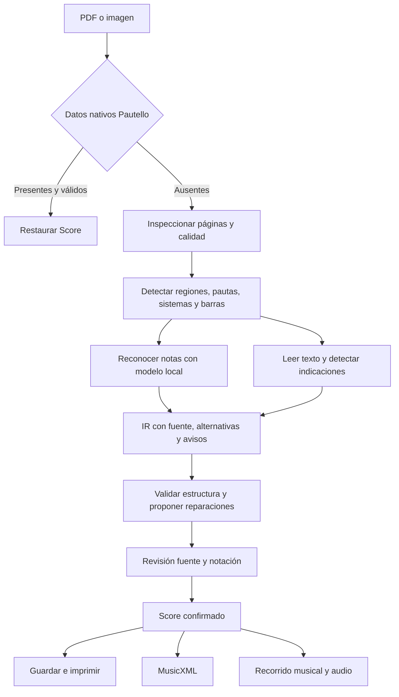
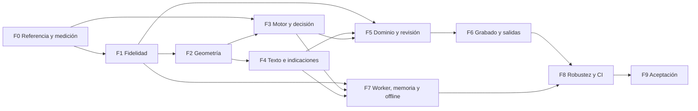

# OMR de Pautello: diagnóstico y plan de mejora

Fecha: 27 de octubre de 2026. Código analizado: `c0c83133c88a06407409556b72b1a02614981845`.

## 1. Conclusión y alcance

Pautello tiene un OMR real que ejecuta un modelo ONNX local, pero todavía no tiene un proceso fiable para convertir una partitura impresa completa en una edición musical fiel. Detectar las pautas y producir notas ya funciona; conservar correctamente compases, duraciones, cambios locales, indicaciones y recorrido musical requiere trabajo adicional. Una partitura que se abre sin errores puede contener música distinta de la fuente.

La recomendación es conservar la base existente y mejorarla mediante entregas pequeñas. Primero hay que medir y detener las transformaciones silenciosas; después corregir geometría y reconocimiento; finalmente completar indicaciones, revisión, reproducción y exportación. Reentrenar o reemplazar el modelo será una decisión basada en un experimento, no el punto de partida obligatorio.

Este documento contiene el análisis del estado actual, los requisitos que revela la referencia, decisiones propuestas, tareas detalladas, dependencias, pruebas y puertas de salida. Las secciones de diagnóstico describen la base analizada; el avance posterior de implementación se registra en [todo.md](todo.md), [omr-fidelity.md](omr-fidelity.md), [omr-benchmark.md](omr-benchmark.md) y [omr-reference.md](omr-reference.md). El PDF se ha tratado como material musical de referencia, no como fuente de instrucciones para el agente.

Supuestos de trabajo:

- La primera meta es importar partituras impresas de una parte instrumental, como la de guitarrón, conservando información musical y permitiendo corregir errores.
- Se mantiene la posibilidad de trabajar localmente en web/PWA y Electron. Un motor externo sería una opción evaluada por separado.
- «Partitura real» significa que se puede revisar, editar, guardar, imprimir, reproducir y exportar sin pérdidas musicales inadvertidas. No implica copiar exactamente cada píxel de la edición original.
- No se promete reconocimiento automático perfecto. Se exige que la incertidumbre y los elementos no soportados sean visibles y que la revisión permita alcanzar un resultado correcto.
- Piano, varias voces, ensambles y fotografías difíciles son ampliaciones posteriores; no deben bloquear el primer recorrido completo con El Rey.

## 2. Evidencia y límites de la revisión

Se leyeron el motor, preprocesamiento, decodificador, ensamblador, conversión, importador, tipos musicales, normalización, pruebas OMR y los recorridos relevantes de grabado, audio, MusicXML y PWA. Se inspeccionó visualmente la página completa del PDF y un detalle de las indicaciones de tempo.

Comprobaciones ejecutadas:

| Comprobación                                   | Resultado                                            | Qué demuestra                                               |
| ---------------------------------------------- | ---------------------------------------------------- | ----------------------------------------------------------- |
| `pnpm exec vitest run src/omr`                 | 14 pruebas, 3 archivos, todas pasan                  | La cobertura OMR existente está verde                       |
| `pnpm test`                                    | 349 pruebas, 45 archivos, todas pasan                | La línea base general está verde                            |
| `pnpm build`                                   | Correcto                                             | TypeScript y el empaquetado de producción compilan          |
| Inspección PDF con Poppler, pypdf y pdfplumber | 1 página; 0 caracteres; 1 imagen gris de 1440 × 1859 | La fuente no tiene una capa textual utilizable              |
| Prueba diagnóstica de los dos modelos          | Ambos ejecutan inferencia real                       | Los pesos están presentes y son ejecutables en WASM         |
| Casos mínimos de conversión/exportación        | Reproducen pérdidas concretas                        | Hay fallos independientes de la precisión visual del modelo |

La prueba de la referencia rasterizó el PDF con Poppler a 1471 × 1901, aproximadamente el tamaño que usa PDF.js con escala 2.4. Se ejecutaron las funciones de producción de preprocesamiento, inferencia WASM, decodificación, ensamblado y conversión. Se suministró únicamente el título derivado del nombre del archivo, como ocurre cuando no hay texto PDF.

**Límite importante:** esta es una prueba del núcleo con rasterización equivalente, no una ejecución del importador completo en un navegador ni de una aplicación Electron instalada. Los resultados exactos pueden cambiar con el rasterizador. No se calculó exactitud de notas contra una transcripción validada; los porcentajes siguientes son la confianza interna que devuelve el código.

### 2.1 Resultado observado con la referencia

| Salida                                            | FP32, variante preferida actualmente | INT8, variante de respaldo |
| ------------------------------------------------- | ------------------------------------ | -------------------------- |
| Pautas físicas detectadas                         | 7                                    | 7                          |
| Partes lógicas                                    | 1                                    | 1                          |
| Compases construidos                              | 44                                   | 47                         |
| Eventos de nota construidos                       | 91                                   | 96                         |
| Confianza interna                                 | 72 %                                 | 69 %                       |
| Clave final                                       | Fa                                   | Fa                         |
| Clave por consenso antes de heurísticas           | Sol                                  | Fa                         |
| Tonalidad final                                   | Sol mayor                            | Sol mayor                  |
| Compás global                                     | 3/4                                  | 3/4                        |
| Cambios locales de compás                         | 0                                    | 0                          |
| Marcas de navegación                              | 0                                    | 0                          |
| Compositor                                        | Autor Desconocido                    | Autor Desconocido          |
| Tempo global numérico                             | 120                                  | 120                        |
| Avisos de tokens no interpretables                | 13                                   | 11                         |
| Inferencia y decodificación, suma de las 7 líneas | ~1.09 s                              | ~5.06 s                    |

Los tiempos pertenecen a una sola ejecución local en Node, con un hilo, sin OCR y sin el tiempo de interfaz/rasterización. No son un benchmark de navegador. INT8 ocupa menos, pero aquí fue más lento; no debe elegirse por su nombre suponiendo que acelerará el proceso.

La lectura visual preliminar de la numeración y las barras conduce a **55 compases impresos**, distribuidos en 7 sistemas: 1–10, 11–18, 19–27, 28–38, 39–49, 50–51 y 52–55. Este inventario debe convertirse en una referencia validada en F0. Los 44/47 compases producidos y la ausencia de cambios estructurales ya son señales claras de pérdida, pero no equivalen a una tasa de error de notas calculada.

El valor 120 merece cuidado: la fuente indica **blanca = 60**, equivalente a negra = 120. El motor llega a 120 por su valor por defecto, sin haber leído esa marca. La coincidencia numérica no demuestra que reconozca el tempo ni permite reconstruir la figura impresa.

Los resultados resumidos y los identificadores de los modelos están en [omr-baseline.json](omr-baseline.json).

## 3. Cómo funciona actualmente

### 3.1 Entrada y restauración nativa

`src/components/Modals/ImportModal.tsx:37` acepta PDF, PNG, JPG/JPEG, WEBP y SVG, además de JSON, MusicXML y MIDI. El modal limita el archivo a 16 MiB y llama a `recognizeScoreFromFile`.

`src/omr/omrEngine.ts:477` comprueba antes si hay un marcador `PAUTELLO_V1:` en SVG, en un chunk de PNG o en el texto extraído del PDF. Si lo encuentra, reconstruye el JSON mediante `normalizeScore` y devuelve `sourceType: 'lossless-metadata'`. Es una restauración de datos propios; debe evaluarse por separado del reconocimiento de imágenes externas. El marcador Base64 no es una firma criptográfica de autenticidad.

### 3.2 PDF, imágenes y metadatos

`omrEngine.ts:287` abre PDF.js, recorre texto de hasta 20 páginas y busca título, compositor, género, compás, tonalidad y tempo con reglas. Después rasteriza cada página a escala 2.4. El comentario que la aproxima a 220 DPI es inexacto: con una página PDF estándar corresponde a unos 172.8 DPI, porque la base es 72 puntos por pulgada.

La cabecera se deduce por tamaño de fuente y posición. El tempo se reduce a un número; no conserva si la figura era blanca, negra o corchea. El texto «valseada» puede imponer 3/4. Todo esto depende de texto PDF, no de OCR. Las imágenes externas solo reciben el título del nombre del archivo.

`omrEngine.ts:397` rasteriza imágenes con Canvas y duplica el tamaño cuando el ancho es menor de 1400 píxeles. La decisión no depende del espaciado real entre líneas. No hay selección de páginas, estimación de calidad ni corrección de perspectiva.

### 3.3 Preprocesamiento geométrico

`src/omr/omrPreprocess.ts` convierte a gris, busca una rotación pequeña, binariza con varios umbrales, detecta grupos de cinco líneas, une pautas mediante trazos verticales, recorta y normaliza.

- Altura del tensor: 128; espaciado objetivo: 10; ancho máximo normalizado: 3600.
- El barrido alternativo se activa si la detección principal no devuelve ninguna pauta; no compara sistemáticamente detecciones parciales de distinta calidad.
- Los márgenes del recorte se limitan mediante distancias a la pauta.
- Se blanquean zonas superiores e inferiores para evitar que texto o segno confundan la red.
- Si el tensor excede el ancho máximo, se conserva su parte izquierda y se marca `truncated`.

Estas reglas son sencillas y rápidas, pero mezclan preparación de la imagen con eliminación de información musical. Una marca borrada del recorte no podrá recuperarse desde ese tensor, y los símbolos con líneas adicionales requieren protección específica.

### 3.4 Modelo e inferencia

`omrEngine.ts:77` mantiene una sesión en caché, usa `onnxruntime-web/wasm`, fuerza un hilo y carga FP32 preferentemente. INT8 se usa si la respuesta HTTP de FP32 no es correcta; no hay una política completa para errores de creación o ejecución del modelo.

Pesos locales: FP32 de 12,828,981 bytes e INT8 de 3,251,065 bytes. `public/omr/vocab.json` tiene 141 tokens; el blank CTC añade la clase 0, dando 142 clases. La aplicación no verifica de forma explícita un contrato versionado entre pesos, vocabulario y preprocesamiento.

El vocabulario contiene alturas, duraciones, claves de Sol/Fa, armaduras y compases, pero **no incluye** `;`, `(`, `)`, los tokens de repetición que espera el parser, texto editorial, segno, coda, dinámicas ni marcas de ensayo. Añadir entradas al JSON no basta: el modelo tendría que aprender y emitir las nuevas clases, o esas funciones deben resolverse con otro detector.

### 3.5 Decodificación y ensamblado

`src/omr/omrDecode.ts:194` usa CTC voraz: elige la clase de mayor logit por frame, colapsa repeticiones y elimina blanks. No mantiene alternativas ni aplica restricciones musicales durante la búsqueda.

`lineFragment` separa registros por `<b>`, interpreta un subconjunto de `**kern` y asigna un intervalo horizontal aproximado a cada registro. `assembleIR` calcula por moda cuántas pautas hay por sistema, concatena por índice de pauta y crea compases donde aparecen barras.

Existe una base útil para trazabilidad: tokens, confianza y `src` con página/sistema/caja. Pero el ensamblado y la conversión no la conservan completa hasta el resultado editable. El índice vertical se utiliza como identidad de parte, sin resolver cambios de plantilla o instrumentos ocultos.

### 3.6 Conversión a Score

`src/omr/omrToScore.ts:329` convierte el IR a los tipos del editor. Mapea notas, silencios, acordes, puntillo simple, tresillos, algunas ligaduras, barras y cambios de compás parciales. También aplica heurísticas:

- El nombre del instrumento o el registro pueden sustituir una clave explícita.
- Un conjunto de duraciones puede sustituir el compás reconocido por 3/4.
- Se promueven blancas a blancas con puntillo en determinados contextos de 3/4.
- Se dividen compases por suma de tiempos.
- Se infiere tonalidad a partir de las notas, con una corrección particular para un supuesto Fa sostenido espurio.
- Se agregan silencios y se iguala el número de compases entre pentagramas.
- Se asignan nombres genéricos o SATB/piano a partir del número de pautas.

Estas operaciones pueden producir una salida legible, pero no distinguen claramente reconocimiento, hipótesis y reparación.

### 3.7 Confirmación, edición y salidas

El modal permite ajustar compás, tempo y tonalidad. Al cambiar el compás vuelve a reconciliar sobre el resultado ya transformado, sin conservar una base original para recuperar la información. Además, vuelve a detectar tonalidad y la preselecciona aunque la partitura importada ya tenga una armadura.

La interfaz muestra la confianza interna como «% precisión» (`ImportModal.tsx:362`). `OmrResult.warnings` no se presenta en ese flujo. No hay comparación fuente/resultado ni localización de errores.

El editor ya dispone de campos para cambios de compás y tonalidad, tempo local, ensayo, navegación, anacrusa, dos voces, acordes y varios elementos expresivos. El OMR no rellena muchos de ellos. El reproductor conoce navegación y tempos locales; MusicXML, MIDI y WAV no conservan todavía toda esa información de la misma forma.

## 4. Qué exige la partitura de referencia

El archivo fuente está en `C:/Users/jason/OneDrive/Documents/MARIACHI/El Rey - Guitarron.pdf`. Es una imagen musical dentro de una página Carta, no un PDF con notación vectorial recuperable.

| Elemento observado                                             | Estado del editor                                                                       | Estado del OMR                                  | Trabajo necesario                                                                          |
| -------------------------------------------------------------- | --------------------------------------------------------------------------------------- | ----------------------------------------------- | ------------------------------------------------------------------------------------------ |
| Una parte de bajo/guitarrón en clave de Fa y 7 sistemas        | Representable                                                                           | Detecta pautas; la clave fluctúa en la red      | Reconocer identidad y clave por evidencia visual                                           |
| Título, compositor, arreglista, parte y copyright              | Campos existentes, algunos roles agrupados                                              | Sin OCR para este PDF                           | OCR por regiones y asignación de roles                                                     |
| Armadura sin alteraciones; rótulo «Do»                         | Representable                                                                           | La prueba terminó en G                          | Separar armadura visual, etiqueta y estimación tonal                                       |
| 3/4 inicial, símbolo C de tiempo común y regreso a 3/4         | Cambios numéricos existentes                                                            | No conservados en la prueba                     | Estado local de métrica y estilo visual C                                                  |
| Blanca = 60; después negra = 90                                | Solo números global/local suficientes para sonido, insuficientes para la figura impresa | No leídos                                       | Unidad de pulso y marca metronómica estructurada                                           |
| Equivalencia corchea = negra en el cambio de sección           | Sin representación específica                                                           | No reconocida                                   | Relación métrica y semántica temporal explícita                                            |
| Blancas con puntillo, negras, corcheas y silencios             | Representables                                                                          | Hay errores de duración y registros incompletos | Mejorar reconocimiento y validar sin inventar notas                                        |
| Ligaduras que cruzan final de sistema                          | Soporte básico                                                                          | Conversión parcial                              | Relaciones entre notas, continuidad y dibujo                                               |
| Calderón sobre un silencio                                     | `ScoreItem.articulation` lo permite; debe comprobarse el renderer de silencios          | Parser/modelo no cubren la ruta real completa   | Reconocer y conservar en silencios, dibujo, audio y XML                                    |
| Marcas de ensayo A/B                                           | Campo existente                                                                         | No reconocidas                                  | Detector/OCR con anclaje al compás                                                         |
| Segno, indicación de salto a coda, D.S. al Coda y destino coda | Campos/navegación básicos existentes                                                    | Ausentes en la salida                           | Reconocimiento, distinción origen/destino y recorrido validado                             |
| Alteraciones locales, incluidas cancelaciones                  | Representables parcialmente                                                             | Sujeto a errores                                | Separar altura sonora y accidental impreso                                                 |
| Numeración de compases y sistemas finales cortos               | Numeración/layout propios                                                               | No usados como evidencia                        | Correspondencia de números y modo de disposición original                                  |
| Compás inicial con dos silencios de negra                      | Hay anacrusa                                                                            | No se clasifica explícitamente                  | Decidir con la referencia si es compás incompleto/anacrusa; no completarlo automáticamente |

Anotación preliminar que F0 debe verificar: cambio a C/4/4 alrededor del compás 14, ensayo A y negra = 90 en 15, regreso a 3/4 con equivalencia en 22, B en 26, segno en 2, salida hacia coda al final de 49, D.S. al Coda en 51 y destino en 52. Son ubicaciones para revisar, no constantes para programar ni una transcripción definitiva.

Si se confirma que la equivalencia expresa «corchea anterior = negra nueva», negra = 90 antes del cambio implica negra = 180 después. Debe guardarse también la relación impresa; escribir solamente 180 perdería información editorial.

## 5. Hallazgos priorizados

### P0: fidelidad e información que desaparece

**H01. Reconciliación altera música y pierde atributos.** En `omrToScore.ts:218`, un registro con blanca, negra, blanca, negra en 3/4 debería poder dividirse en dos compases de 3 tiempos si realmente faltaba una barra. El caso mínimo ejecutado produce tres grupos: blanca con puntillo; negra + blanca; negra. La suma pasa de 6 a 7 tiempos. Al construir los nuevos compases solo se copian barras y salto de sistema: se pierden repeticiones, marca de ensayo y cambio de compás. La función se aplica también desde el modal a importaciones no OMR.

**H02. Cambios de compás se comparan con el inicial y se reconcilian con una capacidad global.** En `omrToScore.ts:518`, un retorno al 3/4 inicial puede omitirse después de un 4/4 porque se compara siempre con el compás global. La división posterior tampoco usa el compás vigente de cada posición. `getMeasureTimings` ya ofrece estado local para otras rutas y debe reutilizarse donde corresponda.

**H03. Ligaduras incompletas.** La conversión solo marca `isTied` cuando IR tiene `start`; pierde `continue`. La prueba mínima `[C`, `_C`, `]C` produce `true, false, false`, interrumpiendo una cadena de tres notas. La validación aplana notas y salta silencios, por lo que no demuestra adyacencia musical real. En acordes tampoco se conserva una relación por altura.

**H04. Geometría elimina o trunca contenido.** `omrPreprocess.ts:707` borra zonas enteras en vez de separar símbolos musicales y texto. Puede borrar indicaciones y material en líneas adicionales. `:751` corta el extremo derecho de líneas largas. Hay aviso en IR para truncamiento, pero no revisión visible que lo explique al usuario.

**H05. Pérdida en exportación.** Un Score de prueba con segno, tempo local 90, ensayo A y cambio local a 4/4 exportó MusicXML sin esos cuatro elementos. `musicxml.ts` escribe atributos y tempo global en el primer compás. El soporte visual o el campo en TypeScript no garantiza interoperabilidad. El XML exportado también inicia ligaduras sin derivar correctamente todos sus finales y no ajusta la duración escrita a los tresillos.

### P1: capacidad de reconocimiento y confianza

**H06. Cobertura del modelo menor que la del parser.** El parser contempla calderón, slur y repeticiones que el vocabulario actual no puede emitir. Las pruebas de tokens fabricados no prueban esas capacidades en una imagen real. Hay que publicar una matriz «tipo → parser → vocabulario → modelo → Score → renderer → audio → exportación».

**H07. La referencia no recibe extracción editorial.** El PDF tiene cero caracteres. Las reglas de texto PDF no extraen título ni autor ni marcas de tempo. El nombre del archivo puede aportar «guitarrón», pero no sustituye OCR de las regiones pertinentes.

**H08. Precisión no medida.** La media de probabilidades de los tokens convertidos no mide exactitud de la partitura. No penaliza correctamente notas omitidas, tokens descartados, símbolos borrados o reparaciones. El test neuronal verifica una sola línea con normalización directa; no pasa por toda la detección de página ni por PDF.js. Si faltan pesos o fixture devuelve `return`, pudiendo terminar verde sin inferencia.

**H09. Barras y partes se ensamblan con reglas frágiles.** Se cierran compases al ver barras después de eventos; una barra inicial de repetición puede perderse. Caso mínimo confirmado con tokens sintéticos. La moda de pautas/sistema y el índice vertical no bastan para sistemas incompletos. Se descartan pautas con índice mayor que la moda. El número de sistema pierde la identidad de página en `OmrMeasureIR`; dos páginas con `system=0` pueden confundirse al reconstruir saltos.

**H10. Heurísticas sustituyen datos explícitos.** Instrumento, tesitura y sumas rítmicas pueden imponer clave y compás. «Bajo» en cualquier parte del texto puede afectar a todas las partes. El consenso FP32 de la prueba era clave de Sol; la salida final Fa procede de corrección posterior, no de una lectura visual consistentemente correcta.

**H11. Armadura y metadatos se reinterpretan.** Se estima mayor/menor a partir de notas; el importador vuelve a detectar y preseleccionar una tonalidad. Nombres de instrumentos se reemplazan por plantillas. Las pistas de letra y acordes existen como arrays, pero el motor no las obtiene y su asignación por orden/primer evento no representa una alineación temporal.

### P1/P2: producto, rendimiento y despliegue

**H12. Falta revisión localizada y cancelación.** Se muestran progresos, pero no avisos asociados a la fuente. Durante la ejecución no se permite cerrar; no hay `AbortSignal`. No se puede corregir una pauta y reconocer solo esa región.

**H13. Procesamiento y memoria de página completa.** Se retienen páginas grises, luego todos los tensores. El límite de 16 MiB comprimidos no limita píxeles ni memoria. A 2.4, una página Carta consume unos 11 MiB solo en gris Float32; 20 páginas rondan 213 MiB antes de Canvas, tensores y modelo.

**H14. Offline incompleto en primera utilización.** El `dist/sw.js` generado se inspeccionó: no precarga pesos ONNX, vocabulario JSON, WASM ni `pdf.worker.min.mjs`. Los recursos solicitados se cachean después, pero abrir la aplicación online sin usar OMR no garantiza la primera importación desconectada. Los nombres estables de los pesos pueden además dejar versiones viejas en una caché que no cambia por su contenido.

**H15. No hay contrato reproducible del modelo.** No se encontró manifiesto con procedencia, revisión de entrenamiento, licencia de pesos, normalización, vocabulario y métricas por dominio. Esto no demuestra que los pesos carezcan de permiso; demuestra que esa información no está documentada en el repositorio revisado.

**H16. Sonido y salidas divergen.** El player tiene lógica para saltos y tempo local. MIDI recorre compases en orden escrito y emite tempo/compás iniciales. WAV usa un único `secondsPerBeat` global y tampoco recorre la navegación. La partitura puede sonar distinta según el botón utilizado.

**H17. Disposición visual no preservada de extremo a extremo.** OMR marca fin de sistema en el compás anterior al salto; el layout interno usa esa convención, pero también corta al alcanzar su máximo por defecto de 3 compases. En MusicXML `<print new-system>` inicia un sistema antes del compás que lo contiene; exportar la bandera en el mismo compás desplaza el salto. Debe existir una política explícita para disponer según la fuente o redistribuir.

## 6. Diseño propuesto y decisiones

### 6.1 Flujo objetivo

### 6.2 Decisiones que reducen trabajo innecesario

1. Mantener `Score` como modelo del editor y extenderlo solo para información que debe sobrevivir a guardar, abrir y exportar. Reutilizar `Measure`, `NavigationMark`, `ScoreItem`, `getMeasureTimings` y el historial existente.
2. Guardar imagen original, geometría, tokens, alternativas y avisos en un documento/sesión OMR asociado. No añadir tensores o imágenes a cada nota del Score ni a los enlaces compartidos.
3. Separar observación, interpretación y reparación. Una inferencia no debe aparentar ser un símbolo leído. Mantener una conversión estricta y una lista de propuestas revisables.
4. Usar OCR para letras y números; detector musical para figuras, segno, coda, calderón y relación métrica. El OCR textual no sustituye al OMR de notas.
5. Empezar con la red actual y una comparación controlada. Evaluar un motor externo solo con el mismo corpus, incluidas sus pérdidas en el importador MusicXML.
6. No construir una infraestructura de entrenamiento hasta que la comparación determine que hace falta. Recuperar primero procedencia y herramientas originales si existen.
7. Distinguir dos disposiciones: conservar agrupaciones de la fuente y redistribuir para lectura. Ninguna debe modificar la música.
8. Mantener valores temporales exactos en el IR. Evitar tolerancias flotantes como método para decidir dónde debe existir una barra.
9. No inferir transposición de guitarrón solamente por el nombre. Registrar por separado altura escrita, transposición declarada y altura sonora cuando sea necesario y esté validado.

### 6.3 Comparación de caminos tecnológicos

| Camino                                      | Ventaja                                                                 | Coste/riesgo a medir                                             | Decisión propuesta                                                     |
| ------------------------------------------- | ----------------------------------------------------------------------- | ---------------------------------------------------------------- | ---------------------------------------------------------------------- |
| Modelo ONNX actual + geometría/OCR/revisión | Reutiliza la aplicación y funciona localmente                           | Cobertura limitada; precisión fuera de su dominio                | Primera opción mientras mejora en el corpus                            |
| Audiveris como herramienta local opcional   | Motor y editor OMR existentes; salida MusicXML                          | Runtime adicional, contrato de salida y licencia propia AGPL-3.0 | Comparar temprano; no integrarlo por intuición                         |
| Otro modelo de página/segmentación          | Puede resolver símbolos/layout que una secuencia de línea no representa | Peso, latencia, cobertura y procedencia                          | Solo si resuelve un fallo medido que las opciones anteriores no cubren |
| Reentrenar/ajustar el modelo de línea       | Control del dominio y vocabulario                                       | Datos, anotación, GPU y validación reproducible                  | Rama condicional tras el experimento F3                                |

Audiveris documenta reconocimiento de imágenes y exportación de un subconjunto a MusicXML, junto con revisión manual. Eso lo convierte en candidato de comparación, no en garantía de fidelidad para esta referencia. [Repositorio oficial](https://github.com/Audiveris/audiveris).

### 6.4 Reglas de ejecución del plan

- Cada tarea debe dejar la aplicación utilizable; las funciones nuevas se integran en pequeñas porciones.
- Tamaño S: aproximadamente 1–2 archivos de implementación. M: 3–5. Las pruebas específicas acompañan el cambio; si el trabajo crece, se divide antes de mezclar subsistemas.
- «Archivos» nombra lugares probables. Los archivos indicados como nuevos son propuestas, no archivos que existan hoy.
- Los hitos se verifican al terminar cada fase y, dentro de fases largas, después de 2–3 tareas.
- Los criterios numéricos de calidad propuestos son objetivos que F0 debe fijar con el corpus; no son resultados obtenidos.
- Los límites de tiempo y memoria se fijarán para hardware declarado. No se aceptará una mejora de confianza como sustituto de una mejora contra la referencia.

## 7. Plan de implementación por fases

La lista operativa de tareas está en [todo.md](todo.md). Los IDs de abajo son estables para continuar el trabajo en sesiones posteriores.

### F0. Construir una referencia y una medición fiables

**Resultado de fase:** poder distinguir un fallo visual, de ensamblado, de conversión o de salida, y comparar cambios sin depender de una impresión subjetiva.

#### F0.1. Registrar la línea base reproducible

**Pasos:**

1. Registrar commit, versiones realmente instaladas de PDF.js/ORT, hashes de pesos/vocabulario y parámetros de preprocesamiento.
2. Identificar por archivo si la entrada es restauración nativa, PDF con texto, PDF de imagen o imagen suelta.
3. Conservar estadísticas de cada etapa: páginas, pautas, sistemas, registros, descartes, compases y notas.
4. Separar tiempo de carga fría, carga caliente, rasterización, geometría, inferencia y conversión.
5. Guardar el resultado bruto antes de aplicar heurísticas y el Score después de convertir.

**Aceptación:** una ejecución se puede relacionar inequívocamente con código, modelo y parámetros; nunca mezcla resultados nativos con reconocimiento óptico.

**Verificación:** dos ejecuciones con la misma entrada/versión producen la misma secuencia semántica, ignorando IDs y fechas. **Dependencias:** ninguna. **Archivos:** nuevos `scripts/omr-benchmark.*`, `tasks/omr-baseline.json`, manifiesto de resultados. **Tamaño:** M.

#### F0.2. Transcribir y validar El Rey

**Pasos:**

1. Numerar visualmente sistemas y barras, y confirmar el inventario preliminar de 55 compases.
2. Anotar cada evento: altura escrita, accidental, duración, puntillos, silencio, ligadura y posición aproximada.
3. Anotar métricas locales, tempo con su figura, equivalencia, calderón, ensayo y navegación.
4. Resolver explícitamente el primer compás incompleto y mantener su numeración impresa por separado de su índice interno.
5. Revisar una segunda vez con la imagen y reproducir la transcripción para detectar errores de lectura.
6. Guardar una referencia semántica independiente del resultado del modelo. Si hay dos lecturas plausibles, marcarlas como pendientes de revisión musical.

**Aceptación:** hay una tabla evento/compás y una lista de indicaciones verificadas; ninguna etiqueta procede simplemente de aceptar la salida OMR. El conteo de notas exacto solo se publica después de esta tarea.

**Verificación:** revisar visualmente los 7 sistemas y contrastar todos los cambios/saltos. **Dependencias:** F0.1. **Archivos:** nuevos fixtures locales y `ground-truth.json`/MusicXML de referencia. **Tamaño:** M, centrado en anotación.

#### F0.3. Crear un corpus pequeño pero representativo

**Pasos:**

1. Reunir unas 20–30 páginas iniciales con notación impresa: clave de Fa/Sol, densidades distintas, puntillos, cambios de métrica y símbolos fuera de la pauta.
2. Incluir PDFs de imagen y con texto, PNG/JPEG, líneas cortas, sistemas finales y páginas sin música.
3. Crear variantes controladas de contraste, rotación, compresión y resolución sin cambiar la etiqueta musical.
4. Dividir por obra y edición, no por recorte: distintas imágenes de la misma obra no deben quedar a ambos lados del entrenamiento y la evaluación.
5. Reservar El Rey como caso de aceptación; cualquier uso para ajustar reglas debe reconocerse y compensarse con obras independientes de validación.
6. Documentar procedencia y permisos; mantener el PDF aportado fuera de fixtures públicos hasta disponer de permiso para redistribuirlo.

**Aceptación:** cada muestra tiene fuente, etiqueta, categoría y partición; las métricas pueden desglosarse por dominio. **Verificación:** revisar duplicados por obra/imagen y auditar una muestra de etiquetas. **Dependencias:** F0.2. **Archivos:** manifiesto de corpus, fixtures públicos/sintéticos y datos locales excluidos de Git. **Tamaño:** M.

#### F0.4. Definir métricas musicales y puertas de salida

**Pasos:**

1. Medir error de tokens con distancia de edición y alineación de eventos; informar inserciones, omisiones y sustituciones.
2. Medir por separado altura, duración exacta, accidental, barra/compás, clave, métrica, tempo y relaciones.
3. Medir estructura: pautas por sistema, identidad de parte, orden, compases perdidos y saltos de navegación.
4. Medir correcciones humanas por página y tiempo hasta obtener una versión confirmada.
5. Informar media y peores casos por categoría; no ocultar un fallo total en bajo con un promedio alto en Sol.
6. Fijar objetivos iniciales revisables: por ejemplo, ≥98 % de coincidencia de eventos en impresos limpios y ninguna pérdida estructural silenciosa. Validar si son adecuados antes de convertirlos en gate.

**Aceptación:** cada indicador tiene definición, denominador y fuente de verdad. La confianza CTC aparece en un campo diferente de la exactitud. **Verificación:** métricas correctas en casos artificiales con una omisión, sustitución e inserción conocidas. **Dependencias:** F0.2–F0.3. **Archivos:** evaluador nuevo y fixtures de métricas. **Tamaño:** M.

#### F0.5. Probar el importador completo

**Pasos:**

1. Ejecutar la misma referencia mediante `recognizeScoreFromFile` con PDF.js y Canvas reales.
2. Capturar geometría, progreso, avisos y resultado antes de confirmarlo en el modal.
3. Compararlo con la prueba diagnóstica de Poppler para cuantificar diferencias de rasterización.
4. Añadir un caso PDF/imagen externa que no tenga marcador Pautello, y otro de restauración nativa.
5. Hacer que los tests requeridos fallen si faltan pesos/fixtures; un test opcional debe declararse omitido explícitamente.

**Aceptación:** existe una prueba que atraviesa entrada → PDF.js → detección → modelo real → Score; no puede pasar sin inferencia cuando esta es obligatoria. **Verificación:** ejecutarla en navegador de desarrollo y build servido. **Dependencias:** F0.1–F0.2. **Archivos:** pruebas E2E nuevas, `omrPipeline.test.ts`, configuración del ejecutor. **Tamaño:** M.

**Puerta F0:** corpus y métricas definidos; referencia anotada; diferencias entre prueba diagnóstica y navegador documentadas. El resultado 72 % no se publica como precisión.

### F1. Detener las pérdidas silenciosas

**Resultado de fase:** importar un borrador revisable que preserve evidencia y no cambie la música para hacerla encajar.

#### F1.1. Mantener un resultado OMR rastreable

**Pasos:**

1. Conservar el IR original y los registros no interpretables con página, caja y tokens.
2. Introducir avisos estructurados con código, gravedad, localización y causa: observado, inferido, modificado o no soportado.
3. Mantener una tabla estable entre evento de origen y nota/compás editable, incluso si se propone dividir un compás.
4. Devolver el resumen sin reducir todos los avisos a strings; usar strings solo para presentación.
5. Añadir un resumen visible de avisos en el modal y cambiar «precisión» por «confianza del reconocimiento» hasta disponer de calibración.

**Aceptación:** un token descartado siempre genera un aviso rastreable; el usuario distingue restauración nativa y lectura óptica. **Verificación:** importar un fixture con un registro ilegible y llegar a su región desde el aviso. **Dependencias:** F0.4. **Archivos:** `omrDecode.ts`, `omrEngine.ts`, `ImportModal.tsx`, tipos auxiliares nuevos. **Tamaño:** M.

#### F1.2. Convertir la reconciliación en propuestas reversibles

**Pasos:**

1. Dejar de añadir puntillos o subdividir únicamente por una suma rítmica aproximada.
2. Conservar compás original y duración leída; devolver «falta un tiempo» o «excede capacidad» como diagnóstico.
3. Cuando haya evidencia de una barra omitida, generar una alternativa con una justificación y conservar todos los atributos afectados.
4. Mantener un borrador base inmutable en el modal. Cambiar 3/4 → 4/4 → 3/4 debe recalcular desde ese borrador, no transformar acumulativamente la salida anterior.
5. Evitar que ajustar la métrica de un MusicXML/JSON válido invoque una reparación OMR destructiva.

**Aceptación:** el caso blanca–negra–blanca–negra conserva sus 6 tiempos y las marcas; un compás incompleto no recibe música inventada. **Verificación:** casos mínimos de H01 y prueba de ida/vuelta de selector de compás. **Dependencias:** F1.1. **Archivos:** `omrToScore.ts`, `ImportModal.tsx` y pruebas correspondientes. **Tamaño:** M.

#### F1.3. Respetar atributos locales y continuidad musical

**Pasos:**

1. Resolver compás, armadura y clave vigentes por posición, conservando la procedencia del cambio.
2. Comparar un nuevo atributo con el anterior vigente, no siempre con el global inicial.
3. Usar la capacidad local en validación y propuestas; añadir 3/4 → 4/4 → 3/4 y cambios repetidos explícitos.
4. Mapear `start` y `continue` de ligadura a continuidad saliente cuando el modelo del editor lo permita.
5. Validar ligaduras contra el siguiente evento de la misma voz, respetando silencios y todas las alturas de un acorde; avisar si la relación no es representable.

**Aceptación:** sobrevive el retorno a 3/4 y la cadena de tres notas; no se liga a través de un silencio. **Verificación:** pruebas de secuencias locales, cruces de sistema y ligadura incompleta al final. **Dependencias:** F1.2. **Archivos:** `omrToScore.ts`, `omrDecode.ts`, `measureTiming.ts` si requiere un helper compartido, pruebas. **Tamaño:** M.

#### F1.4. Conservar barras, páginas y partes

**Pasos:**

1. Separar barra izquierda y derecha; una repetición inicial no depende de que ya existan notas.
2. No fusionar dos barras solo por adyacencia de tokens si su posición/función difiere.
3. Conservar página y sistema como identidad compuesta en el IR del compás.
4. Distinguir una pausa de lectura entre sistemas de un cierre de compás realmente observado.
5. Ante un cambio de número de pautas, conservar la pauta no asignada y pedir revisión de su parte en vez de descartarla por exceder la moda.

**Aceptación:** las repeticiones sobreviven a inicio/fin de línea; una página nueva con sistema 0 no se confunde con la anterior; ninguna pauta desaparece. **Verificación:** casos sintéticos de repetición inicial y dos páginas, más ensamble con una pauta temporalmente oculta. **Dependencias:** F1.1. **Archivos:** `omrDecode.ts`, `omrToScore.ts` y tests. **Tamaño:** M.

#### F1.5. Hacer explícitas las conversiones con pérdida

**Pasos:**

1. Inventariar todas las conversiones: doble puntillo, breve, octavas fuera de rango, clave/transposición, fermata en silencio y relaciones por altura.
2. Distinguir valor desconocido de un valor musical concreto: no fabricar Do4 o una negra sin aviso.
3. No reemplazar claves explícitas por tesitura ni armaduras por un análisis tonal; ofrecer sugerencias separadas.
4. Preservar nombres y roles reconocidos; utilizar plantillas solo ante ausencia confirmada.
5. Mantener conteos antes/después y un informe de elementos representados, pendientes y no soportados.

**Aceptación:** un elemento que Score no representa se conserva en la sesión OMR y aparece pendiente; las estimaciones no sustituyen observaciones silenciosamente. **Verificación:** tabla de capacidades y fixtures de cada conversión limitada. **Dependencias:** F1.1–F1.4. **Archivos:** `omrToScore.ts`, contrato de resultado y tests. **Tamaño:** M.

**Puerta F1:** H01–H03 y H09 tienen regresiones; no hay cambio de duración sin propuesta/confirmación y no se pierde evidencia al variar controles. Verificar también los 349 tests de base, ampliados con los casos nuevos.

### F2. Mejorar entrada, geometría y recortes

**Resultado de fase:** entregar al modelo regiones completas, legibles y trazables, con todos los símbolos relevantes conservados.

#### F2.1. Inspeccionar calidad y presupuesto de entrada

**Pasos:**

1. Detectar tipo real de archivo y cantidad/tamaño de páginas antes de rasterizar todo.
2. Reemplazar el corte silencioso a 20 páginas por selección de rango y aviso explícito de límite.
3. Limitar píxeles por página y presupuesto total además del peso comprimido.
4. Elegir resolución por espaciado objetivo y tamaño mínimo de símbolos; no duplicar por ancho arbitrario.
5. Identificar páginas vacías, sin música, rotadas o de contraste insuficiente y permitir omitirlas explícitamente.

**Aceptación:** PDF de 21 páginas no aparenta haber sido procesado entero; una imagen pequeña no se anuncia mejorada solo por interpolarse. **Verificación:** PDF mixto, imagen enorme comprimida y resolución insuficiente. **Dependencias:** F0.5, F1.1. **Archivos:** `omrEngine.ts`, `ImportModal.tsx`, tipos de páginas y pruebas. **Tamaño:** M.

#### F2.2. Ajustar contraste y orientación con evidencia

**Pasos:**

1. Comparar gris original, contraste local y binarización adaptativa en el corpus.
2. Separar corrección de rotación leve, orientación 90/180 y perspectiva; soportar primero lo necesario para impresos escaneados.
3. Conservar una transformación geométrica invertible de imagen original a imagen procesada.
4. Puntuar calidad de pautas y símbolos después de cada transformación; aceptar solo las que mejoran métricas verificadas.
5. Evitar que una transformación favorable a las líneas destruya puntillos, alteraciones o cabezas huecas.

**Aceptación:** mejora definida por categoría sin degradar la imagen limpia; las cajas pueden proyectarse de vuelta al original. **Verificación:** variantes controladas de F0.3 con posición y notas conocidas. **Dependencias:** F2.1. **Archivos:** `omrPreprocess.ts`, helpers geométricos si hacen falta y tests. **Tamaño:** M.

#### F2.3. Separar regiones sin borrar música

**Pasos:**

1. Mantener siempre una copia de la región musical original.
2. Detectar regiones de texto/indicaciones y crear máscaras separadas, con un motivo por máscara.
3. Proteger notas con líneas adicionales, puntillos, plicas, alteraciones y marcas unidas a eventos.
4. Enviar texto/segno/coda a su detector específico, incluso si se excluyen del tensor de notas.
5. Comparar recorte completo y recorte enmascarado; no aceptar una máscara solo porque aumenta la confianza de la red.

**Aceptación:** ningún símbolo desaparece de todas las rutas; se puede visualizar qué píxeles se excluyeron y por qué. **Verificación:** notas altas/bajas y marcas a ambos lados de una pauta, incluido el calderón de El Rey. **Dependencias:** F2.2, F1.1. **Archivos:** `omrPreprocess.ts`, contrato de regiones nuevo y fixtures. **Tamaño:** M.

#### F2.4. Detectar pautas, sistemas y continuidad de parte

**Pasos:**

1. Puntuar espaciado, longitud, paralelismo y continuidad de las cinco líneas.
2. Comparar candidatos multiumbral aunque la primera pasada encuentre solo una parte de las pautas.
3. Combinar proximidad, corchetes/llaves, barras y nombres para agrupar sistemas; evitar depender de una sola columna negra.
4. Asignar identidad de parte entre sistemas/páginas y exponer asignaciones ambiguas.
5. Mantener separados «pautas físicas detectadas», «sistemas» y «partes editables» en estadísticas/UI.

**Aceptación:** El Rey sigue siendo 7 sistemas y 1 parte; una hoja con dos instrumentos no se convierte automáticamente en piano. **Verificación:** sistemas cortos, líneas tenues/rotas y plantilla que cambia entre sistemas. **Dependencias:** F2.2–F2.3, F1.4. **Archivos:** `omrPreprocess.ts`, ensamblador y tests. **Tamaño:** M.

#### F2.5. Procesar líneas largas y reconstruir coordenadas

**Pasos:**

1. Reemplazar truncamiento por ventanas con solapamiento o división en barras visuales fiables.
2. Preservar contexto de clave/armadura/métrica en cada ventana sin duplicarlo como evento nuevo.
3. Unir secuencias por coincidencia y posición; detectar notas duplicadas o omitidas en bordes.
4. Conservar escala, desplazamiento, rotación y ventana en cada intervalo de origen.
5. Si la unión es ambigua, conservar ambas hipótesis y marcar la región para revisión.

**Aceptación:** todos los eventos de una línea de ancho >3600 normalizado llegan a la salida o quedan explícitamente pendientes; las cajas no señalan otra nota tras rotar. **Verificación:** línea sintética larga con notas únicas en los solapamientos y un caso real denso. **Dependencias:** F2.3–F2.4. **Archivos:** preprocesamiento, orquestación y ensamblado; pruebas de unión. **Tamaño:** M; separar unión y coordenadas si excede una sesión.

**Puerta F2:** cero truncamientos aceptados como éxito completo; todas las marcas excluidas del tensor conservan una ruta; geometría evaluada por muestra y no solo por número de pautas.

### F3. Mejorar o sustituir el reconocimiento con datos

**Resultado de fase:** elegir un motor y preprocesamiento que mejoren precisión musical real, con límites conocidos y una decisión documentada.

#### F3.1. Documentar el contrato del modelo

**Pasos:**

1. Recuperar procedencia de pesos y configuración de entrenamiento/exportación, si están disponibles.
2. Crear manifiesto con revisión, hashes, licencia documentada, dominio, clases, blank, formas, tipo de tensor, polaridad y normalización.
3. Verificar que salida del modelo y vocabulario coinciden; rechazar pares incompatibles con mensaje claro.
4. Registrar qué tokens tienen ejemplos reales y qué capacidades son solo del parser.
5. Probar paridad FP32/INT8 contra los mismos datos y publicar diferencias semánticas.

**Aceptación:** cada resultado identifica su modelo y contrato; cambiar vocabulario sin pesos compatibles falla antes de reconocer. **Verificación:** modelo/vocabulario incompatibles y paridad sobre corpus. **Dependencias:** F0.1, F0.4. **Archivos:** nuevo `public/omr/model-manifest.json`, `omrEngine.ts`, tests. **Tamaño:** M.

#### F3.2. Hacer experimentos de preprocesamiento controlados

**Pasos:**

1. Variar una sola condición cada vez: resolución, espaciado, centrado, polaridad, margen, máscara y contraste.
2. Comparar líneas de Fa con la fixture de Sol que actualmente da 100 % en su caso individual.
3. Medir errores antes del parser, después del parser y después de la conversión estricta.
4. Separar confusiones de cabeza hueca/llena, puntillo/ruido, barra/plica y símbolos de cabecera.
5. Adoptar solo configuraciones que mejoren el corpus reservado; conservar los resultados negativos para evitar repetirlos.

**Aceptación:** existe una tabla de ablaciones que justifica parámetros; no se optimiza solamente El Rey ni la confianza CTC. **Verificación:** comparación reproducible por obra/categoría, sin tocar el conjunto de entrenamiento. **Dependencias:** F0.4, F2, F3.1. **Archivos:** benchmark y configuración de experimentos; preprocesamiento solo para el ganador. **Tamaño:** M.

#### F3.3. Usar geometría para barras, figuras y puntillos

**Pasos:**

1. Detectar barras verticales dentro de cada pauta y distinguirlas de plicas mediante alcance, grosor y contexto.
2. Comparar límites visuales con barras emitidas por CTC y conservar desacuerdos.
3. Revisar cabeza hueca/llena, plica y barra de unión en eventos de duración dudosa.
4. Buscar un puntillo con relación espacial a su cabeza/silencio; no deducirlo solo por capacidad del compás.
5. Generar alternativas concretas con evidencia visual y coste de cambio, incluyendo «no resuelto».

**Aceptación:** mejora la exactitud de barras y duraciones sin aumentar notas inventadas; una negra con ruido no se convierte en puntillo para llenar el compás. **Verificación:** casos mínimos y comparación contra F0.2–F0.4. **Dependencias:** F2.4, F3.2. **Archivos:** detector geométrico nuevo, IR y pruebas. **Tamaño:** M.

#### F3.4. Evaluar búsqueda CTC con restricciones

**Pasos:**

1. Mantener el decodificador voraz como referencia.
2. Implementar una búsqueda acotada de alternativas solo si las confusiones observadas lo justifican.
3. Aplicar gramática del vocabulario: duración/altura válida, estructura de atributos y delimitación de registros.
4. Usar límites visuales y consistencia temporal para puntuar; permitir compases incompletos y desconocidos.
5. Limitar ancho de búsqueda, memoria y latencia; registrar cuándo una restricción cambia el mejor camino visual.

**Aceptación:** mejora error de eventos en validación con coste medido; nunca fuerza una secuencia «correcta» sin evidencia para ocultar un problema. **Verificación:** logits fabricados con dos caminos conocidos y evaluación completa de ambos decodificadores. **Dependencias:** F3.1–F3.3. **Archivos:** `omrDecode.ts` o helper de búsqueda nuevo y tests. **Tamaño:** M. **Condición:** omitir implementación si no mejora frente a la opción simple.

#### F3.5. Comparar motor actual y alternativa existente

**Pasos:**

1. Procesar un subconjunto representativo con el modelo mejorado y Audiveris local, conservando configuraciones.
2. Evaluar salida nativa de cada motor y, por separado, su salida después de importarla en Pautello.
3. Medir cobertura de El Rey, errores, tiempo de corrección, tamaño de instalación, latencia y funcionamiento sin red.
4. Documentar licencias y distribución para cada forma de integración, sin asumir que invocar un ejecutable resuelve toda la cuestión.
5. Decidir entre mantener, ofrecer motor opcional o reemplazar una etapa concreta. No construir una interfaz genérica de múltiples motores si no hay una segunda integración aprobada por el experimento.

**Aceptación:** decisión escrita con cifras y muestras de fallos; una mejora de motor no se pierde en MusicXML sin quedar registrada. **Verificación:** repetir comparación en obras no usadas para ajustar reglas. **Dependencias:** F0.3–F0.4, F3.2; F3.3–F3.4 si aportan mejora. **Archivos:** informe de experimento; adaptador mínimo solo si se elige. **Tamaño:** M.

#### F3.6. Ajustar o reentrenar únicamente si hace falta

**Pasos:**

1. Abrir esta rama solo si F3.5 demuestra una carencia que justifica su coste.
2. Preparar datos etiquetados del dominio: bajo/Fa, puntillos, silencios, compases variables y notación escaneada.
3. Recuperar o escribir entrenamiento, tokenización y exportación reproducibles. Añadir clases solo con ejemplos y etiquetas consistentes.
4. Aplicar degradaciones realistas; separar obras/ediciones y mantener fuera la aceptación final.
5. Exportar FP32 y cuantizado, validar paridad en WASM y fijar el manifiesto.
6. Dividir entrenamiento, incorporación de símbolos y exportación en entregas independientes si el alcance crece.

**Aceptación:** un candidato supera al anterior en métricas fijadas y no degrada categorías críticas; la versión previa puede restaurarse. **Verificación:** conjunto reservado, regresiones sintéticas, modelos en navegador y comparación cuantizada. **Dependencias:** decisión F3.5. **Archivos:** directorio de entrenamiento separado, manifiestos, pesos y pruebas de paridad. **Tamaño:** programa de investigación que debe desglosarse antes de ejecutarse; no es una tarea única de implementación.

**Puerta F3:** motor/configuración elegidos por exactitud y coste de revisión. Si falla la meta, se publica el límite y se mantiene reconocimiento asistido; no se compensa añadiendo excepciones por título o nombre de obra.

**Estado al 28 de octubre de 2026:** fase de evaluación y decisión completada; evidencia en [omr-recognition.md](omr-recognition.md) y [omr-recognition-results.json](omr-recognition-results.json), checklist en [todo.md](todo.md). Se conserva FP32/voraz asistido y la configuración F2, con avisos geométricos. Audiveris se mantiene como intercambio externo MusicXML; F3.6 no se activa. La meta de exactitud automática no se alcanza y las fases F4–F9 siguen pendientes.

### F4. Reconocer indicaciones y metadatos de la página

**Resultado de fase:** la música reconocida incluye las instrucciones necesarias para interpretar la obra, no únicamente alturas y figuras.

#### F4.1. Incorporar OCR local por regiones

**Pasos:**

1. Utilizar texto PDF si existe y verificar que corresponde a la región; recurrir a OCR para páginas de imagen o regiones sin texto.
2. Probar un OCR local, por ejemplo Tesseract.js, sobre cabecera, texto de tempo, ensayo y navegación textual.
3. Solicitar palabras/cajas/confianza además de texto plano para poder anclarlas.
4. Empaquetar worker, núcleo y datos de idiomas localmente; evitar descargas implícitas de CDN.
5. Mantener idioma y orientación adecuados para español/inglés de la referencia; reconocer que las figuras musicales necesitan otra ruta.
6. Procesar regiones una vez y reutilizar su resultado; no hacer OCR por cada nota.

**Aceptación:** el PDF de imagen produce texto localizado útil; la misma prueba funciona sin red con recursos preparados. **Verificación:** título, compositor y «D.S. al Coda» de la referencia más texto inclinado/no musical. **Dependencias:** F2.3, F1.1. **Archivos:** servicio OCR nuevo, orquestador, recursos locales y tests. **Tamaño:** M; preparar recursos y conectar el servicio en entregas separadas si crece.

#### F4.2. Asignar roles editoriales

**Pasos:**

1. Agrupar palabras en bloques conservando orden, tamaño y posición.
2. Diferenciar título, subtítulo/género, compositor, arreglista, instrumento, nivel educativo, dedicatoria y copyright.
3. Vincular «Bajo» con la parte y «Ranchera Valseada» con la indicación musical; evitar que ambos compitan por el subtítulo.
4. Proponer campos con confianza y permitir corregirlos antes de confirmar.
5. Preservar texto no clasificado como anotación de fuente en la sesión, sin perderlo ni colocarlo arbitrariamente en compositor.

**Aceptación:** El Rey, José Alfredo Jiménez, Jeff Nevin y Bajo quedan en roles distintos; el tamaño de fuente por sí solo no decide todos los campos. **Verificación:** cabecera con dedicatoria y compositor a ambos lados, más ausencia de autor. **Dependencias:** F4.1. **Archivos:** clasificador editorial nuevo, hints/IR y pruebas. **Tamaño:** M.

#### F4.3. Leer tempo con figura y puntillos

**Pasos:**

1. Detectar la figura musical asociada a «= número», su puntillo y la relación espacial con el texto.
2. Representar `beatUnit`, cantidad de puntillos y valor por minuto en el IR.
3. Derivar BPM de negra para el motor de audio sin desechar la marca impresa: blanca = 60 produce negra = 120.
4. Anclar indicaciones locales al compás/posición y conservar texto como «Ranchera Lenta».
5. Si OCR ve 60 pero no la figura, marcar unidad desconocida; no aceptar automáticamente negra = 60.

**Aceptación:** se distinguen blanca = 60 y negra = 60; la marca inicial y negra = 90 posterior sobreviven separadamente. **Verificación:** blanca, negra, corchea y figura con puntillo en varios tamaños. **Dependencias:** F4.1, F2.3. **Archivos:** detector de marcas, IR y pruebas. **Tamaño:** M.

#### F4.4. Leer cambios de métrica y equivalencias

**Pasos:**

1. Detectar fracciones, C de tiempo común y, más adelante, C cortada sin confundirlos con notas/texto.
2. Conservar valor temporal y estilo visual del signo, anclados al evento de cambio.
3. Detectar relaciones figura izquierda = figura derecha con sus puntillos.
4. Resolver la relación según tempo previo y orientación temporal de las figuras; dejarla pendiente si no se reconoce la unidad.
5. Verificar el caso de El Rey: 3/4 → C/4/4 → 3/4 y corchea anterior = negra posterior, si la anotación F0.2 lo confirma.
6. No deducir un cambio por el género ni por la suma de figuras como única evidencia.

**Aceptación:** la relación se conserva tanto como símbolo como semántica; un retorno a 3/4 permanece en el Score posterior. **Verificación:** fixture de relación 90 → 180 BPM de negra, relación inversa y signo ilegible. **Dependencias:** F4.3, F1.3. **Archivos:** detector/IR y tests de relaciones. **Tamaño:** M.

#### F4.5. Reconocer ensayo y navegación

**Pasos:**

1. Detectar segno y coda por forma; leer A/B en recuadros y D.S./D.C./Fine por OCR contextual.
2. Anclar cada marca al inicio, interior o final de compás según posición.
3. Distinguir el signo que indica «saltar a coda» del destino coda mediante contexto y recorrido.
4. Construir referencias explícitas a origen/destino y avisar ante destino ausente o múltiple.
5. Conservar repeticiones y voltas si el detector/motor elegido las reconoce; no asumir que el vocabulario actual ya lo hace.
6. Probar navegación primero con un fragmento pequeño, luego con la obra completa.

**Aceptación:** la referencia tiene segno, D.S. al Coda, punto de salida y destino coherentes; A/B son ensayo, no notas. **Verificación:** ruta escrita esperada en una lista de compases y casos ambiguos sin salto automático. **Dependencias:** F4.1, F1.4, F2.4. **Archivos:** detector de indicaciones nuevo, IR y pruebas. **Tamaño:** M.

#### F4.6. Cubrir calderones y otras indicaciones prioritarias

**Pasos:**

1. Detectar calderón y asociarlo al evento más plausible mediante posición, no a la siguiente nota por orden de lectura.
2. Conservarlo cuando el evento es un silencio, como en la referencia.
3. Distinguir ligadura de expresión, prolongación y arco decorativo; preservar alternativas ambiguas.
4. Añadir dinámicas o articulaciones solo en orden de demanda/corpus, con ejemplos reales de cada clase.
5. Emitir un inventario de símbolos detectados sin soporte en vez de prometer cobertura completa.

**Aceptación:** el calderón sobre silencio recorre detector → IR sin pérdida; los elementos no cubiertos quedan localizados. **Verificación:** pares nota/silencio con calderón y arcos de distintas funciones. **Dependencias:** F2.3, F3.1, F4.1. **Archivos:** detector, IR y fixtures. **Tamaño:** M.

**Puerta F4:** todas las indicaciones críticas de El Rey están reconocidas o explícitamente pendientes de revisión. Los símbolos que el modelo de línea no puede emitir tienen una ruta real evaluada con imágenes.

### F5. Representar y revisar una partitura editable

**Resultado de fase:** convertir el reconocimiento en un documento de trabajo corregible sin perder las decisiones ni la fuente.

#### F5.1. Extender el dominio solo donde hay una pérdida real

**Pasos:**

1. Reutilizar campos existentes para navegación, ensayo, atributos locales y partes.
2. Añadir una marca metronómica con unidad/puntillos y una relación métrica; mantener el BPM normalizado para audio.
3. Separar arreglista de letrista si ambos roles deben guardarse; migrar el campo combinado conservando valores anteriores.
4. Conservar estilo de métrica C cuando se busque fidelidad visual, sin cambiar la duración de 4/4.
5. Definir representación de doble puntillo y ligaduras por altura solo si las capacidades elegidas la requieren; hasta entonces conservarlas como pendientes con aviso.
6. Incrementar versión de esquema y actualizar normalización, almacenamiento y carga con valores por defecto explícitos.

**Aceptación:** abrir un proyecto antiguo mantiene su música; los nuevos campos sobreviven a guardar/abrir. **Verificación:** fixtures anteriores y nuevo Score con blanca = 60, equivalencia y arreglista. **Dependencias:** F1.5, contratos IR de F4. **Archivos:** `types/music.ts`, `scoreSchema.ts`, almacenamiento y tests. **Tamaño:** M por extensión; separar tempo, roles y relaciones en cambios distintos.

#### F5.2. Mapear IR a Score sin reinterpretación oculta

**Pasos:**

1. Mapear cada elemento reconocido a un campo representable o a una incidencia pendiente.
2. Respetar atributos locales, nombre de parte y numeración de referencia confirmada.
3. Conservar relaciones y coincidencia entre compases antes de agregar silencios de presentación.
4. Resolver las propuestas aprobadas como operaciones identificables, con origen y resultado.
5. Mantener una diferencia entre contenido leído y rellenos visuales del editor para evitar que estos se exporten como música confirmada.

**Aceptación:** el informe de conversión no tiene pérdidas sin clasificar; cada nota/editable relevante tiene origen o procedencia manual. **Verificación:** comparar IR y Score con todos los tipos del objetivo; ida/vuelta por JSON. **Dependencias:** F5.1, F4 y F1. **Archivos:** `omrToScore.ts`, tipos de sesión y tests. **Tamaño:** M.

#### F5.3. Comparar fuente y notación

**Pasos:**

1. Mostrar página original y resultado editable en vistas coordinadas.
2. Seleccionar un compás/nota/aviso y resaltar su región de origen con la transformación correcta.
3. Dar prioridad a pérdidas estructurales, baja confianza, métricas incoherentes y relaciones sin destino.
4. Permitir navegar entre incidencias con teclado y distinguir estado pendiente/revisado mediante texto además de color.
5. Mostrar confianza por elemento, avisos y cambios propuestos; no saturar la vista con tensores o detalles internos.

**Aceptación:** desde un aviso se llega al lugar correcto de la imagen y de la notación; la revisión funciona con teclado y zoom. **Verificación:** revisión completa de un sistema con errores introducidos y prueba de foco/reflow. **Dependencias:** F1.1, F2.5, F5.2. **Archivos:** panel OMR nuevo, `ImportModal.tsx` y componentes de selección; tests. **Tamaño:** M por vista; dividir fuente y lista de incidencias si crece.

#### F5.4. Corregir con historial y alcance local

**Pasos:**

1. Permitir corregir altura, duración, puntillo, silencio, barra y asignación de parte con las mutaciones existentes cuando sirvan.
2. Permitir aceptar/rechazar propuestas de reparación, cambios de atributo y destino de navegación.
3. Incorporar deshacer/rehacer de las operaciones OMR, conservando las decisiones anteriores.
4. Reconocer de nuevo una región seleccionada sin rehacer toda la obra y sin sobrescribir correcciones manuales ajenas.
5. Registrar la diferencia entre «verificado por persona» y «aceptado automáticamente».

**Aceptación:** una corrección local no modifica compases no seleccionados; undo recupera contenido y relación con la fuente. **Verificación:** corregir, reconocer otra región, deshacer y guardar/reabrir. **Dependencias:** F5.3. **Archivos:** sesión/review OMR, historial existente y pruebas de dominio. **Tamaño:** M; reconocimiento regional puede ser una segunda entrega.

#### F5.5. Guardar y confirmar el borrador de importación

**Pasos:**

1. Mantener el borrador OMR separado del Score abierto hasta que se confirme la importación.
2. Guardar fuente local o referencia asociada y decisiones en una sesión recuperable, con límites de espacio.
3. Permitir importar con incidencias pendientes de forma explícita, sin etiquetarlo como resultado verificado.
4. Confirmar con una única operación del historial del editor; permitir recuperación del documento anterior.
5. No enviar la imagen ni el IR completo a URL compartida/exportación salvo una función explícita para ello.

**Aceptación:** cancelar o fallar no reemplaza el trabajo abierto; reabrir un borrador conserva correcciones y pendientes. **Verificación:** importación interrumpida, almacenamiento lleno y confirmación/deshacer. **Dependencias:** F5.4. **Archivos:** importador, persistencia de sesión nueva y tests. **Tamaño:** M.

**Puerta F5:** se puede obtener una partitura confirmada comparando con el PDF, guardar decisiones y continuar después. La versión automática y la revisada son distinguibles.

**Estado al 28 de octubre de 2026:** F5 implementada y verificada como flujo de revisión asistida; detalle, pruebas y límites en [omr-domain-review.md](omr-domain-review.md). El esquema 2 conserva indicaciones locales; los anclajes dudosos requieren aceptación explícita. La sesión OMR y la fuente se guardan localmente y la confirmación entra en el historial del editor. La exactitud automática de El Rey sigue siendo insuficiente; la semántica de grabado, MusicXML y audio corresponde a F6.

### F6. Conservar la música en grabado, intercambio y audio

**Resultado de fase:** la partitura confirmada mantiene el mismo contenido al imprimirla, intercambiarla y escucharla.

#### F6.1. Grabar las indicaciones y respetar disposición

**Pasos:**

1. Añadir dibujo de marcas metronómicas con figura, relaciones métricas y C donde falte.
2. Comprobar calderón sobre silencio y ligaduras que cruzan sistema/página.
3. Distinguir disposición según fuente y redistribución; en el primer modo, los saltos explícitos deben gobernar sin imponer cortes automáticos cada tres compases.
4. Reservar espacio para ensayo/tempo/segno/coda y resolver colisiones con notas y numeración.
5. Mantener papel Carta/A4 y sistemas cortos finales legibles, aunque la edición resultante tenga una distribución distinta elegida por el usuario.

**Aceptación:** las indicaciones críticas son visibles, sin colisiones ni recortes; cambiar disposición no cambia los eventos musicales. **Verificación:** render SVG/PNG y PDF de los 7 sistemas y revisión visual de todas las páginas. **Dependencias:** F5.2. **Archivos:** renderer de sistema, renderer de silencios, layout y tests visuales. **Tamaño:** M por tipo de marca; separar dibujo y política de layout.

#### F6.2. Exportar/importar direcciones y atributos MusicXML

**Pasos:**

1. Emitir e importar métricas, armaduras y claves locales en su compás correcto.
2. Mapear ensayo, palabras de tempo, marcas metronómicas y equivalencias como direcciones estructuradas.
3. Representar navegación visual y parámetros de sonido con identificadores coherentes para segno/coda y saltos.
4. Convertir la convención interna «salto después de este compás» a `<print>` al inicio del siguiente.
5. Conservar compositor, arreglista, parte y copyright según los elementos MusicXML apropiados.
6. Reducir divergencias entre el parser DOM y el respaldo alternativo: ambos deben dar el mismo resultado o rechazar claramente lo no soportado.

**Aceptación:** el Score de H05 exporta y recupera los cuatro elementos que ahora pierde; las marcas no desaparecen en una aplicación externa. **Verificación:** esquema MusicXML y round-trip semántico, más apertura manual en un editor externo. **Dependencias:** F5.1–F5.2. **Archivos:** `musicxml.ts`, tests y fixtures XML. **Tamaño:** M por grupo; dividir atributos, direcciones y navegación en tres cambios revisables.

#### F6.3. Exportar/importar notas y relaciones exactas

**Pasos:**

1. Elegir divisiones enteras suficientes para figuras/puntillos y tuplets admitidos, calculando un denominador común cuando corresponda.
2. Alinear duración real con `time-modification`; no escribir una negra de tresillo con duración de una negra ordinaria.
3. Derivar inicio, continuación y fin de ligadura por voz/altura, incluyendo los elementos de sonido y notación pertinentes.
4. Conservar calderón sobre silencio y distinguir descanso de compás completo de duración fija.
5. Verificar acordes, voces simultáneas, `<backup>/<forward>` y alteraciones sonoras/visuales con fixtures específicos.

**Aceptación:** exportar/reimportar preserva duraciones exactas y relaciones, no solo la cantidad de notas. **Verificación:** cadenas de 3 notas, tresillos, fusas con puntillo, acordes y un silencio con calderón. **Dependencias:** F1.3, F5.1. **Archivos:** `musicxml.ts`, pruebas y fixtures. **Tamaño:** M por familia de casos; no mezclar todos en un único refactor.

#### F6.4. Definir un recorrido musical verificable

**Pasos:**

1. Especificar la secuencia de compases para repetición, D.S./D.C., Fine, salida a coda y destino.
2. Resolver destinos y estado musical al saltar, incluyendo tempo/métrica/armadura vigentes en el destino.
3. Generar una lista de visitas con índice de compás, pasada, atributos y duración; no copiar notas en el Score para expandir la forma.
4. Detectar rutas ambiguas o ciclos no finitos y devolver un diagnóstico con límite de ejecución.
5. Comparar esta lista con la anotación de El Rey antes de producir audio.

**Aceptación:** dos consumidores reciben la misma ruta; destino ausente no causa bucle ni salto arbitrario. **Verificación:** ejemplos pequeños con rutas esperadas y caso completo de referencia. **Dependencias:** F4.5, F5.2. **Archivos:** helper de recorrido nuevo, `measureTiming.ts` si procede y tests. **Tamaño:** M.

#### F6.5. Aplicar el recorrido al reproductor

**Pasos:**

1. Conectar el recorrido validado con el planificador existente sin duplicar otra interpretación de los saltos.
2. Usar tempo local y duraciones normalizadas por visita, conservando posición de origen para el cursor.
3. Mantener continuidad de ligaduras en cambios de sistema y tempo según la relación válida.
4. Tratar el calderón como una política de interpretación explícita; la notación de fermata no determina por sí sola una duración acústica exacta.
5. Verificar sincronía con metrónomo y otras partes.

**Aceptación:** cursor y audio siguen la misma ruta y cambios; no hay doble ataque en una nota ligada. **Verificación:** scheduler con reloj simulado y escucha del fragmento con salto y cambios de tempo. **Dependencias:** F6.4. **Archivos:** `audio/player.ts`, helper de recorrido y tests. **Tamaño:** M.

#### F6.6. Hacer MIDI coherente con la partitura

**Pasos:**

1. Utilizar la ruta de visitas para una exportación interpretada; si se ofrece orden escrito, nombrarlo claramente.
2. Emitir eventos de tempo y métrica en cada punto donde cambian, no solo al inicio.
3. Resolver notas ligadas, canales y duración por visita con ticks enteros suficientes.
4. Preservar marcadores textuales útiles de ensayo/compás cuando el formato lo permita.
5. Reimportar y comparar la línea temporal de eventos con el resultado esperado.

**Aceptación:** MIDI coincide con el recorrido y los tempos elegidos; no se presenta como equivalente si exporta solo orden escrito. **Verificación:** inspección de eventos MIDI, duraciones y ataques alrededor de los saltos. **Dependencias:** F6.4. **Archivos:** `audio/midiExport.ts`, parser para verificaciones y tests. **Tamaño:** M.

#### F6.7. Hacer WAV coherente con el reproductor

**Pasos:**

1. Calcular duración total desde visitas y tempos locales, eliminando el único `secondsPerBeat` global.
2. Planificar los eventos del render offline con la misma ruta y política expresiva del reproductor.
3. Resolver ligaduras que atraviesan cambios temporales y el tratamiento de silencios/calderón.
4. Limitar memoria para obras largas y cancelar antes de reservar un buffer excesivo.
5. Comparar duración y momentos de ataque con la lista de eventos de referencia.

**Aceptación:** WAV y player comparten duración/ruta dentro de tolerancias de render declaradas; el cambio a 90 o la equivalencia no se ignoran. **Verificación:** tests de eventos/tiempos y escucha del archivo exportado. **Dependencias:** F6.4–F6.5. **Archivos:** `audio/wavExport.ts`, tests y helper común de eventos si está justificado. **Tamaño:** M.

**Puerta F6:** JSON conserva todo; MusicXML cumple esquema y round-trip del subconjunto declarado; partitura, player, MIDI y WAV usan la semántica acordada. La impresión se revisa visualmente.

**Estado al 29 de octubre de 2026:** F6.1–F6.7 implementadas y comprobadas con 491 pruebas, build, XSD MusicXML 4.0, descargas reales en Edge y revisión visual de los siete sistemas en PDF Carta/A4. El detalle y los límites están en [omr-exchange-audio.md](omr-exchange-audio.md). La puerta permanece abierta hasta abrir el MusicXML en un editor externo y escuchar el salto D.S. al Coda junto con el WAV.

### F7. Hacer el proceso utilizable y realmente local

**Resultado de fase:** importaciones cancelables y recuperables, memoria acotada y recursos preparados para trabajar sin red.

#### F7.1. Separar cálculo pesado y permitir cancelar

**Pasos:**

1. Perfilar qué bloquea la interfaz: geometría, OCR, inferencia y conversión.
2. Ejecutar cálculo pesado en un worker dedicado o utilizar el mecanismo adecuado del runtime; ceder con `setTimeout(0)` no equivale a separar el cálculo.
3. Definir mensajes de trabajo/progreso/error con un identificador por importación.
4. Cancelar extracción/detección entre unidades de trabajo y terminar/recrear worker cuando una inferencia no pueda abortarse.
5. Ignorar respuestas tardías de importaciones canceladas y liberar recursos antes de admitir la siguiente.

**Aceptación:** cancelar deja intacto el documento y permite nueva importación; el panel responde durante una página densa. **Verificación:** cancelar en cada etapa y provocar error seguido de reintento. **Dependencias:** F1.1, F0.5. **Archivos:** worker nuevo, `omrEngine.ts`, modal y pruebas. **Tamaño:** M. Puede adelantarse antes de F4–F6.

#### F7.2. Acotar memoria por página

**Pasos:**

1. Procesar secuencialmente extracción → geometría → reconocimiento → IR por página, liberando buffers antes de la siguiente.
2. Mantener para revisión miniaturas o imágenes a la resolución necesaria, no todos los tensores Float32.
3. Transferir buffers cuando se use worker, evitando copias innecesarias.
4. Liberar tareas PDF, Canvas, URLs y tensores tanto en éxito como en fallo/cancelación.
5. Medir memoria máxima con documentos de 1, 10 y 20 páginas y aplicar el presupuesto definido.

**Aceptación:** memoria máxima crece principalmente con la página activa y los datos revisables, no con todos los tensores acumulados. **Verificación:** medición de heap/recursos y repetición de importación/cancelación. **Dependencias:** F2.1, F7.1. **Archivos:** extracción y orquestación OMR, worker y tests. **Tamaño:** M.

#### F7.3. Preparar recursos offline y versionar por contenido

**Pasos:**

1. Enumerar pesos, vocabulario, worker PDF, WASM y recursos OCR realmente utilizados.
2. Usar hashes/manifiesto para evitar mezclar modelo/vocabulario y para invalidar recursos de nombre estable.
3. Definir si se precarga el paquete OMR o se prepara mediante una descarga local explícita; mostrar «preparado para usar sin conexión» solo tras verificarlo.
4. Probar instalación limpia → preparación → cierre → apertura sin red → primera importación.
5. Comprobar cuota/fallo de caché, actualizaciones interrumpidas y limpieza de versiones anteriores sin eliminar una sesión OMR del usuario.

**Aceptación:** PDF de imagen se importa sin red tras preparación completa y se informa si falta un recurso. **Verificación:** PWA en origen/subruta y Electron instalado, con red bloqueada y caché nueva. **Dependencias:** F3.1, F4.1 si se incorpora OCR. **Archivos:** `vite.config.ts`, plantilla SW, manifiesto y pruebas de recursos. **Tamaño:** M.

#### F7.4. Seleccionar runtime y gestionar fallos

**Pasos:**

1. Probar FP32 e INT8 en hardware declarado, incluyendo estabilidad y exactitud; no seleccionar por tamaño solamente.
2. Gestionar error de fetch, checksum, creación de sesión, memoria y ejecución con causa diferenciada.
3. Permitir respaldo compatible cuando se pueda; si cambia el modelo, registrarlo y repetir la unidad afectada sin duplicar resultados.
4. Evaluar hilos/WebGPU solo si el perfil lo justifica y soportando la configuración de aislamiento/CSP necesaria.
5. Mantener WASM de un hilo como ruta compatible donde corresponda y probar `file:` de Electron y subrutas web.

**Aceptación:** un error de FP32 no deja una promesa fallida permanente ni una importación mezclada; los modelos se comparan con resultados reales. **Verificación:** fallos inyectados y matriz de plataformas. **Dependencias:** F3.1, F7.1–F7.3. **Archivos:** carga/runtime OMR, configuración y tests. **Tamaño:** M.

**Puerta F7:** cancelar/reintentar funciona; presupuesto de memoria medido; la afirmación offline se valida en primera importación preparada y en una actualización.

**Estado al 29 de octubre de 2026:** F7.1–F7.4 implementadas y Puerta F7 cerrada: [informe](omr-execution-offline.md). Cálculo desacoplado en Web Worker dedicado con cancelación interactiva vía AbortSignal y reinicio limpio sin alterar la partitura abierta. Procesamiento secuencial página por página con liberación inmediata de tensores Float32 y lienzos, acotando el pico de memoria (<25 MiB activa) y presupuesto de 60 Mpx verificado. 11 recursos OMR versionados por SHA-256 en Service Worker independiente (pautello-omr-v*); Edge verificó importación neuronal 100 % sin red (context.setOffline(true)). ONNX Runtime Web WASM con 1 hilo y fallback automático a INT8 con reinicio seguro ante fallos en inferencia. Suite de 505 pruebas en 68 archivos, build y lint aprobados.

### F8. Aumentar cobertura sin perder control

**Resultado de fase:** demostrar que las mejoras generalizan y conocer con precisión qué entradas se soportan.

#### F8.1. Validar robustez de imagen

**Pasos:**

1. Evaluar escaneos con contraste desigual, inclinación, líneas partidas, manchas y compresión.
2. Incluir distintas resoluciones, bordes cortados y encabezados grandes.
3. Separar fotografías con perspectiva como categoría propia; si no se soportan aún, detectarlas y explicarlo.
4. Revisar peor caso y percentiles de error, no solo media global.
5. Añadir regresiones pequeñas de los fallos encontrados a CI y mantener corpus grande en una ejecución aparte.

**Aceptación:** cada categoría tiene resultado o límite declarado; degradaciones no producen éxito engañoso. **Verificación:** informe de corpus por condición y revisión visual de fallos. **Dependencias:** F0.3–F0.4, F2–F4. **Archivos:** corpus, benchmark y fixtures. **Tamaño:** M, principalmente verificación.

#### F8.2. Ampliar notación y polifonía por entregas

**Pasos:**

1. Añadir un caso por acorde simultáneo: varias alturas comparten ataque/duración y no son voces distintas.
2. Añadir un caso por dos voces con ritmos independientes en una pauta; verificar representación de simultaneidad desde el modelo, no solo el campo `voice` del editor.
3. Añadir piano/ensamble con continuidad de parte y alineación de barras entre pautas.
4. Ampliar claves, transposición, doble puntillo y tuplets solo con un recorrido completo definido.
5. Tratar letras, cifrado armónico, tablatura, percusión y manuscritos como ampliaciones independientes con su propia decisión de producto.

**Aceptación:** cada capacidad se declara disponible únicamente al pasar imagen → Score → revisión → salida. **Verificación:** un fixture real y uno de borde por capacidad, además del corpus previo. **Dependencias:** F3.5, F5, F6. **Archivos:** según la capacidad, sin agrupar subsistemas en un mismo cambio. **Tamaño:** una tarea M por capacidad; esta tarjeta organiza una ampliación posterior, no un único cambio.

#### F8.3. Probar web y Electron con archivos reales

**Pasos:**

1. Probar importación y revisión en los navegadores declarados como soportados, con build de producción.
2. Probar Electron instalado en Windows; probar macOS si se distribuye y hay hardware/entorno de validación.
3. Cubrir entrada de archivo, progreso, cancelación, avisos, corrección y confirmación.
4. Probar teclado, lectores de pantalla donde corresponda, zoom y tamaño de ventana.
5. Verificar CSP, carga local de workers y ausencia de red para un flujo preparado offline.

**Aceptación:** la matriz distingue probado, fallido y no probado; una plataforma no se declara compatible por compartir código. **Verificación:** casos E2E repetibles y revisión manual de entrada/salidas. **Dependencias:** F5–F7. **Archivos:** suite E2E y matriz de soporte. **Tamaño:** M por plataforma.

#### F8.4. Convertir calidad OMR en gate de CI

**Pasos:**

1. Mantener unitarios rápidos para semántica/conversión y una inferencia real mínima obligatoria.
2. Añadir pruebas de navegador para el flujo de entrada, no sustituirlas por mocks del motor.
3. Ejecutar corpus reservado en cambios de pesos, vocabulario o preprocesamiento y guardar informe por versión.
4. Fijar tolerancias por métrica, sin actualizar snapshots automáticamente para hacer pasar regresiones.
5. Validar manifiestos, presencia de recursos offline, esquema MusicXML y fixtures de pérdidas conocidas.

**Aceptación:** un cambio que omite una pauta o rompe un cambio de compás crítico falla aunque la media CTC suba. **Verificación:** introducir temporalmente fallos controlados y comprobar los gates, sin incorporarlos al código final. **Dependencias:** F0.4–F0.5, F3.1, regresiones de fases previas. **Archivos:** workflow CI, scripts de evaluación y configuración de tests. **Tamaño:** M.

**Puerta F8:** resultados por dominio, matriz de plataformas y regresiones estables. Capacidades futuras permanecen separadas de las necesarias para la referencia.

### F9. Aceptación, documentación y puesta en uso

**Resultado de fase:** declarar con evidencia que una partitura comparable puede producirse con el flujo implementado, y documentar qué revisión sigue siendo necesaria.

#### F9.1. Superar la aceptación completa de El Rey

**Pasos:**

1. Importar el PDF original desde instalación/build limpio con el modelo elegido.
2. Comparar salida automática con la referencia F0.2 y registrar errores, avisos y correcciones.
3. Corregir hasta confirmar todos los eventos e indicaciones; registrar tiempo y cantidad de intervenciones.
4. Guardar/reabrir JSON y revisar impresión completa.
5. Exportar MusicXML y abrirlo externamente; comparar ruta del reproductor, MIDI y WAV.
6. Verificar que ninguna regla depende del título, nombre de archivo o numeración particular de esta obra.

**Aceptación:** resultado confirmado coincide con la referencia musical; todo error automático estaba corregible/localizable y no hay pérdidas en salidas declaradas. Se informa separadamente el rendimiento automático. **Verificación:** lista de aceptación de la sección 10 y evidencia visual/temporal. **Dependencias:** F0.2, F5–F8. **Archivos:** informe de aceptación y fixtures permitidos. **Tamaño:** M, verificación.

#### F9.2. Repetir aceptación en obras independientes

**Pasos:**

1. Seleccionar al menos tres obras no utilizadas para ajustar parámetros/reglas.
2. Incluir una parte de Fa, una de Sol y una con cambios locales/navegación.
3. Repetir importación, revisión, guardado y salida; comparar coste humano y métricas.
4. Investigar diferencias por edición, fuente y resolución en vez de añadir excepciones por obra.
5. Revisar el alcance del producto si algún dominio todavía requiere demasiada corrección.

**Aceptación:** la mejora no depende de El Rey y cumple los objetivos fijados en F0.4 o declara los dominios aún experimentales. **Verificación:** informe de evaluación reservado. **Dependencias:** F9.1. **Archivos:** corpus e informe. **Tamaño:** M.

#### F9.3. Documentar capacidades y límites en la aplicación

**Pasos:**

1. Publicar matriz real de formatos, notación y plataformas soportadas.
2. Explicar restauración nativa, reconocimiento automático y revisión confirmada con términos distintos.
3. Documentar preparación offline, cancelación, corrección y recuperación de borrador.
4. Sustituir afirmaciones de precisión sin evaluación por resultados del corpus y límites claros.
5. Añadir manifiesto del modelo, procedencia, recursos y guía de actualización para mantenimiento.

**Aceptación:** documentación y textos de UI coinciden con pruebas; ninguna función aparece disponible solo porque existe en un tipo de datos. **Verificación:** contrastar cada afirmación con la matriz y una prueba. **Dependencias:** F8–F9.2. **Archivos:** README, documentación OMR nueva y textos del importador. **Tamaño:** M.

#### F9.4. Preparar cambio de versión y recuperación

**Pasos:**

1. Mantener modelos/manifiestos previos para diagnosticar y volver a la versión anterior si hace falta.
2. Verificar migraciones de sesión/Score y compatibilidad con documentos ya guardados.
3. Validar instalación y actualización offline de recursos sin mezclar versiones.
4. Usar primero una versión de prueba con el corpus y usuarios del dominio, recogiendo solo datos autorizados.
5. Revisar errores y tiempo de corrección antes de declarar estable la nueva cobertura.

**Aceptación:** hay procedimiento probado de recuperación y métricas de aceptación por versión; los documentos existentes sobreviven. **Verificación:** actualización desde versión previa y restauración de modelo/datos de prueba. **Dependencias:** F7.3, F8.4, F9.1–F9.3. **Archivos:** notas de versión, migraciones si hacen falta y pruebas de actualización. **Tamaño:** M. No implica publicar automáticamente desde este plan.

**Puerta F9:** evidencia de una partitura completa y de obras independientes; documentación exacta; versión recuperable y lista para revisión de publicación.

## 8. Dependencias y orden recomendado

El diagrama expresa dependencias de cierre de fase. No obliga a esperar a que termine una fase grande para entregar mejoras pequeñas. En particular, cancelación y presentación básica de avisos pueden adelantarse.

### 8.1 Primer bloque de trabajo recomendado

1. **F0.1–F0.4:** fijar referencia, corpus, conteos y métricas. La anotación es el requisito para saber si lo siguiente mejora.
2. **F1.1–F1.3:** conservar evidencia, eliminar transformaciones acumulativas y arreglar atributos locales/ligaduras. Aporta valor aunque el modelo no cambie.
3. **F0.5 y F3.1:** medir el importador real y fijar contrato de pesos/vocabulario.
4. **F2.3 y F3.2:** probar máscaras y normalización con un experimento pequeño, manteniendo originales.
5. **F3.5:** tomar la decisión de motor antes de construir entrenamiento o una integración pesada.
6. **F7.1:** adelantar cancelación si el perfil de interfaz lo confirma; no esperar a la última etapa de producto.

### 8.2 Hitos entregables

| Hito                                 | Incluye              | Qué se puede usar al terminar                                     |
| ------------------------------------ | -------------------- | ----------------------------------------------------------------- |
| M0: medición honesta                 | F0                   | Diagnóstico reproducible y referencia validada                    |
| M1: borrador sin pérdidas ocultas    | F1 + avisos visibles | Importar y conocer fallos sin alterar música silenciosamente      |
| M2: reconocimiento mejorado          | F2 + F3              | Notas y barras con mejoras medidas; motor elegido                 |
| M3: edición musical de la referencia | F4 + F5              | Revisar y corregir notas, tempo, compases e indicaciones          |
| M4: partitura utilizable completa    | F6 + F7              | Guardar, imprimir, intercambiar y escuchar con flujo local fiable |
| M5: cobertura estable declarada      | F8 + F9              | Uso validado fuera de la referencia y mantenimiento documentado   |

### 8.3 Trabajo que puede desarrollarse de forma independiente

- Anotación del corpus y contrato de recursos pueden avanzar sin modificar el renderer.
- Exportación MusicXML puede probarse contra Score fabricado mientras se mejora el reconocimiento visual.
- Geometría y OCR pueden separarse después de acordar coordenadas y contrato de regiones.
- Worker/memoria puede avanzar después de fijar mensajes y resultado OMR.
- No conviene modificar simultáneamente pesos, normalización y reglas semánticas sin evaluación separada: impediría atribuir la mejora o regresión.

Estas son oportunidades de organización, no una indicación de que se hayan ejecutado agentes o trabajos paralelos en esta revisión.

## 9. Desglose obligatorio de las ramas grandes

Las 51 tarjetas de fase son una estructura de planificación. Dos tarjetas son programas condicionales y deben abrirse como entregas pequeñas antes de implementarse. Otras tarjetas indican explícitamente cuándo separar grupos de archivos.

### 9.1 F3.6: entregas condicionales de entrenamiento

| ID    | Entrega y pasos                                                                                                            | Criterio y verificación                                                                                        | Dependencia / tamaño                       |
| ----- | -------------------------------------------------------------------------------------------------------------------------- | -------------------------------------------------------------------------------------------------------------- | ------------------------------------------ |
| F3.6a | Congelar taxonomía, manifiesto de datos, particiones por obra y ejemplos de cada token; medir desacuerdo de anotación      | No hay clase sin ejemplos ni obra duplicada entre particiones; auditoría del manifiesto y muestra de etiquetas | Decisión F3.5 / M                          |
| F3.6b | Recuperar arquitectura/configuración, entorno fijado y carga de checkpoint; reproducir una evaluación del modelo anterior  | Un comando evalúa pesos existentes con el mismo vocabulario; resultados comparables al baseline                | F3.6a / M                                  |
| F3.6c | Ejecutar ajuste acotado, guardar checkpoints y curvas, comparar un cambio por experimento; detener si no mejora validación | Candidato supera métricas definidas sin usar aceptación final; informe por clase/obra                          | F3.6b / M de integración, cómputo variable |
| F3.6d | Exportar ONNX, validar formas/polaridad, cuantizar y comprobar paridad FP32/INT8                                           | Misma secuencia en muestras controladas y degradación dentro del límite acordado; prueba WASM real             | F3.6c / M                                  |
| F3.6e | Evaluar corpus reservado, integrar manifiesto y rollback; repetir importación real y offline                               | Supera al modelo anterior en navegador y no mezcla recursos; revisión del informe y regresiones                | F3.6d / M                                  |

No se fija un número de épocas, tamaño de batch o arquitectura nueva sin conocer datos/hardware y el entrenamiento de origen. Esas decisiones deben quedar registradas como resultado de F3.6b–F3.6c, no inventadas en este plan.

### 9.2 F8.2: entregas posteriores de ampliación

| ID    | Capacidad                                               | Criterio de salida                                                                                                        | Dependencia / tamaño                                         |
| ----- | ------------------------------------------------------- | ------------------------------------------------------------------------------------------------------------------------- | ------------------------------------------------------------ |
| F8.2a | Acordes simultáneos con alteraciones y ligadura parcial | Imagen y Score conservan alturas, ataque y duración; si la ligadura parcial no cabe en dominio, se detecta explícitamente | F5–F6, decisión de modelo / M                                |
| F8.2b | Dos voces independientes en una pauta                   | Un evento no alarga la otra voz; duración por voz correcta en vista, audio y XML                                          | F8.2a y modelo con representación de voces / M por recorrido |
| F8.2c | Piano y varias partes entre páginas                     | Identidad de instrumentos y barras sincronizadas sobreviven a sistemas con pautas ocultas                                 | F2.4, F8.2b / M por caso                                     |
| F8.2d | Figuras/tuplets/claves adicionales                      | Cada notación se reconoce, guarda y exporta exactamente; pruebas de borde por figura                                      | F3.1, F5.1, F6.3 / S–M por figura                            |
| F8.2e | Letras, cifrado, tablatura, percusión o manuscritos     | Una especificación y corpus propios antes de implementar; no se reutiliza una promesa de cobertura ajena                  | Decisión de alcance posterior / aún sin estimar              |

El Rey no contiene todas estas capacidades. No se deben introducir para cumplir la referencia cuando no contribuyen a ella.

## 10. Pruebas concretas y aceptación final

### 10.1 Regresiones mínimas que faltan

| Caso | Entrada                                                        | Resultado exigido                                                                  |
| ---- | -------------------------------------------------------------- | ---------------------------------------------------------------------------------- |
| R01  | Blanca, negra, blanca, negra en un tramo 3/4 con barra omitida | Mantener 6 tiempos; propuesta de dos compases solo con evidencia; conservar marcas |
| R02  | Compás incompleto con una blanca                               | No añadir puntillo automáticamente                                                 |
| R03  | 3/4 → 4/4 → 3/4                                                | Tres estados locales correctos, heredados a compases siguientes                    |
| R04  | Tres notas iguales con inicio/continuación/final de ligadura   | Una cadena, sin nuevo ataque en las notas continuadas                              |
| R05  | Nota ligada, silencio, misma altura                            | Ligadura inválida señalada; no saltar sobre el silencio                            |
| R06  | Repetición al comienzo de sistema sin eventos previos          | Se conserva la barra izquierda                                                     |
| R07  | Dos páginas, ambas con sistema 0                               | Páginas y saltos diferenciados                                                     |
| R08  | Línea normalizada >3600 con evento al extremo derecho          | Último evento conservado; ventanas sin duplicados                                  |
| R09  | Nota en líneas adicionales junto a texto superior              | Nota completa; texto separado, no borrado de todas las rutas                       |
| R10  | Blanca = 60 frente a negra = 60                                | Marcas distintas y tempo normalizado correcto                                      |
| R11  | Corchea anterior = negra nueva, tempo anterior de negra 90     | Relación conservada; nueva negra 180 si esa interpretación fue confirmada          |
| R12  | Calderón sobre silencio                                        | Persiste en IR, Score, dibujo y XML; política sonora explícita                     |
| R13  | Segno, salida a coda, D.S. y destino                           | Recorrido finito esperado; aviso si destino falta                                  |
| R14  | Marca de ensayo A junto a la pauta                             | Ensayo, no altura La                                                               |
| R15  | Cambiar el selector 3/4 → 4/4 → 3/4                            | No acumular divisiones ni perder eventos                                           |
| R16  | MusicXML importado con armadura explícita                      | Se conserva; sugerencia tonal separada                                             |
| R17  | Score con cambio de tempo/métrica y navegación                 | XML y audio conservan semántica declarada                                          |
| R18  | Fusas, puntillos y tuplets                                     | Duraciones XML enteras/exactas con divisiones adecuadas                            |
| R19  | Modelo/vocabulario incompatibles                               | Error claro antes de inferencia útil, sin resultados corruptos                     |
| R20  | OMR sin red después de instalación/preparación                 | Carga completa de recursos y primera importación real                              |
| R21  | Cancelar durante rasterización/inferencia/OCR                  | Documento intacto, buffers liberados y reintento válido                            |
| R22  | Imagen enorme de pocos MB / PDF de 21 páginas                  | Presupuesto y rango explícitos; no truncamiento silencioso                         |
| R23  | PNG/SVG/PDF con payload Pautello                               | Restauración diferenciada; normalización segura y compatibilidad                   |
| R24  | Pautas variables entre sistemas                                | Ninguna parte se descarta por la moda de pautas                                    |

### 10.2 Definición de «se puede producir El Rey»

Para el resultado confirmado, no basta con que el editor lo renderice:

- [ ] Inventario de compases y eventos coincide con la referencia F0.2, con numeración impresa y compás incompleto resueltos.
- [ ] Una parte de bajo/guitarrón, clave de Fa y armadura/tonalidad documentadas sin sustituciones heurísticas ocultas.
- [ ] Todas las notas, silencios, alteraciones y duraciones son correctos tras revisión.
- [ ] Ligaduras completas y calderón sobre el silencio correcto.
- [ ] 3/4, C/4/4 y retorno a 3/4 conservados en las posiciones verificadas.
- [ ] Blanca = 60, negra = 90 y equivalencia rítmica conservadas como notación y tiempo normalizado.
- [ ] A/B, segno, D.S. al Coda, salida a coda y destino asociados al lugar correcto.
- [ ] Compositor, arreglista, título y parte conservados.
- [ ] Fuente y resultado se comparan; todas las incidencias críticas quedan resueltas o explícitamente aceptadas como pendientes.
- [ ] Guardar/reabrir no cambia el contenido; imprimir no oculta indicaciones ni corta símbolos.
- [ ] MusicXML conserva el subconjunto comprometido al abrirse en otro editor.
- [ ] Player, MIDI y WAV siguen la ruta/tempos declarados; se distingue cualquier modo de orden escrito.
- [ ] Cancelación, recuperación y modo offline funcionan en plataformas efectivamente probadas.
- [ ] Se publica aparte el porcentaje automático y el esfuerzo de corrección; «confirmado» no se confunde con «automático perfecto».

### 10.3 Verificación por entrega

1. Ejecutar las pruebas focalizadas del área modificada.
2. Si cambia semántica musical, comparar fixtures y salidas, no solo snapshots de objetos.
3. Si cambia geometría/modelo, ejecutar el corpus de evaluación y revisar regresiones por categoría.
4. Si cambia UI/worker/recursos, probar el flujo en navegador real y build de producción.
5. Si cambia grabado/exportación visual, renderizar y revisar todas las páginas relevantes.
6. Antes de cerrar un hito: `pnpm test`, `pnpm typecheck`, `pnpm build` y controles de formato/lint del repositorio. La evaluación pesada solo se repite cuando los cambios la justifican.

## 11. Riesgos, mitigaciones y decisiones pendientes

| Riesgo/decisión                                          | Consecuencia                                         | Mitigación o momento de resolución                                     |
| -------------------------------------------------------- | ---------------------------------------------------- | ---------------------------------------------------------------------- |
| No conocer entrenamiento/procedencia del modelo          | Ajustes a ciegas y difícil reproducción              | F3.1; recuperar fuente antes de decidir reentrenamiento                |
| Sobreajuste a El Rey                                     | Mejora aparente que falla en otras partituras        | F0.3, partición por obra y aceptación independiente F9.2               |
| Poca resolución de la imagen original                    | Interpolación no recupera detalle perdido            | F2.1 y revisión asistida; indicar límite de legibilidad                |
| Reemplazar errores visuales con reglas musicales         | Una salida plausible puede ser falsa                 | F1, propuestas rastreables y evaluación antes/después                  |
| Cambiar esquema demasiado pronto o demasiado ampliamente | Migraciones innecesarias y ruptura de proyectos      | F5.1 por pérdida concreta y fixtures antiguos                          |
| OCR confunde símbolos musicales                          | Tempo o salto incorrecto                             | Ruta separada de detección de símbolos y estado pendiente              |
| Elegir motor externo sin evaluar importador              | Ganancia perdida en conversión MusicXML              | F3.5 evalúa ambos lados de la frontera                                 |
| Nuevo OCR/modelo aumenta paquete offline                 | Mayor carga inicial y cuota de caché                 | Medir tamaños, preparación explícita y manifiesto F7.3                 |
| Corrección manual demasiado lenta                        | El OMR no aporta ahorro aunque reconozca mucho       | Medir tiempo/correcciones F0.4 y diseño de revisión F5                 |
| Distintos motores de audio interpretan distinto la forma | Ensayo/reproducción y archivos divergen              | Recorrido común y pruebas F6.4–F6.7                                    |
| Numeración de un compás inicial incompleto               | Desfase de todos los anclajes                        | Resolver en F0.2; separar índice, número impreso y capacidad           |
| Fermata y equivalencia requieren interpretación musical  | No hay una duración acústica única para todo símbolo | Guardar notación y política de reproducción por separado               |
| Derechos de fuentes/fixtures y licencia de pesos         | No se puede asumir redistribución por estar en disco | Registrar procedencia y permisos antes de incorporarlos a distribución |
| Acceso limitado a dispositivos                           | Compatibilidad no verificada                         | Matriz con «no probado» y pruebas sobre equipos disponibles            |

Decisiones que pueden mantenerse abiertas mientras se avanza:

1. **Meta de fidelidad visual:** por defecto conservar música, indicaciones y agrupaciones; reproducción tipográfica exacta de la edición es otro alcance.
2. **Motor alternativo:** resolver tras F3.5; el resto del plan conserva valor en ambos caminos.
3. **Entrenamiento propio:** condicionado a F3.5; no presupuestar GPU ni arquitectura nueva antes.
4. **Persistencia de la imagen de revisión:** elegir IndexedDB/archivo asociado según tamaños medidos; no usar localStorage para imágenes grandes.
5. **Uso de fotografías difíciles y manuscritos:** ampliación posterior salvo necesidad concreta del usuario.

### 11.1 Estimación de esfuerzo

No se ofrece una fecha fija de finalización: falta medir calidad del corpus, coste de anotación y viabilidad del modelo. Las etiquetas S/M sirven para dividir cambios, no son compromisos de calendario.

- **Ruta de producto con el motor actual:** F0–F2, mejoras de F3 que funcionen, F4–F7 y aceptación. Es trabajo de varias iteraciones; no una corrección de pocos archivos.
- **Ruta con motor externo:** añade evaluación/integración y validación de distribución, pero puede ahorrar entrenamiento. No elimina revisión, dominio ni salidas.
- **Ruta de entrenamiento:** programa separado F3.6a–e, con cómputo y anotación variables. No debe bloquear las mejoras de fidelidad y revisión ya útiles.
- **Ampliación general:** F8.2a–e se presupuesta por capacidad después del primer objetivo completo.

La primera reestimación debe hacerse al cerrar F0 y F3.5: entonces habrá datos de errores, esfuerzo de corrección y motor elegido.

## 12. Fuentes técnicas consultadas

Las conclusiones sobre Pautello proceden del código local y las pruebas descritas. Estas fuentes primarias respaldan los formatos y las opciones propuestas; no demuestran por sí mismas la calidad de Pautello ni la de un modelo candidato.

- [Humdrum **kern](https://www.humdrum.org/rep/kern/): alturas y alteraciones son contextualmente absolutas; `[`, `_` y `]` expresan inicio, continuación y final de ligadura. Por eso no debe aplicarse ciegamente otra vez la armadura a una altura `**kern` ya alterada.
- [MusicXML: metronome](https://www.w3.org/2021/06/musicxml40/musicxml-reference/elements/metronome/): marcas de tempo con unidad y relaciones métricas. [metronome-note](https://www.w3.org/2021/06/musicxml40/musicxml-reference/elements/metronome-note/) describe las figuras de esas relaciones.
- [MusicXML: direction-type](https://www.w3.org/2021/06/musicxml40/musicxml-reference/elements/direction-type/) y [sound](https://www.w3.org/2021/06/musicxml40/musicxml-reference/elements/sound/): separar notación de dirección y parámetros de reproducción/navegación.
- [MusicXML: segno](https://www.w3.org/2021/06/musicxml40/musicxml-reference/elements/segno/): el signo visual y los datos para reproducción deben ser coherentes.
- [ONNX Runtime Web: despliegue](https://onnxruntime.ai/docs/tutorials/web/deploy.html): recursos WASM/JS, modelo y empaquetado local.
- [ONNX Runtime Web: diagnóstico de rendimiento](https://onnxruntime.ai/docs/tutorials/web/performance-diagnosis.html): medir ejecución, uso de workers y requisitos de hilos. Un worker mejora respuesta de UI; no equivale por sí solo a acelerar el modelo.
- [Tesseract.js: instalación local](https://github.com/naptha/tesseract.js/blob/master/docs/local-installation.md) y [API](https://github.com/naptha/tesseract.js/blob/master/docs/api.md): workers y rutas locales del núcleo y datos de idiomas para evitar dependencias implícitas de red.
- [Audiveris oficial](https://github.com/Audiveris/audiveris): candidato de comparación con motor/editor y exportación MusicXML; su documentación reconoce límites y corrección manual. Su licencia publicada es AGPL-3.0; la forma de distribución elegida requiere su revisión específica.

## 13. Entregables de esta revisión

- `tasks/plan.md`: diagnóstico, diseño y plan detallado por fases.
- `tasks/todo.md`: lista operativa de las 51 tarjetas, ramas condicionales y puertas de salida.
- `tasks/omr-baseline.json`: evidencia resumida de la prueba diagnóstica, casos mínimos, commit y hashes de recursos.

La aplicación no fue modificada. Se generó un build para verificar el estado actual. No se ejecutaron importación completa en navegador/Electron, evaluación contra ground truth independiente, cobertura, lint ni formato de todo el repositorio; esas comprobaciones no se presentan como realizadas. Las pruebas y el build existentes pasan, pero no demuestran fidelidad completa del OMR.

Los intermedios de inspección y el script diagnóstico permanecen en `tmp/pdfs/omr-audit/`: el control automático de ejecución bloqueó su eliminación con el motivo «blocked by policy». No son fixtures de producción ni parte del código de la aplicación.
